[TOC]

# 信息收集

```
arp-scan -l
nmap -p- --min-rate 10000 192.168.174.195 | awk -F ' ' '{print$1}' | awk -F '/' '{print$1}' | tr '\n' ','
```

扫到端口21,1515,3535

分别进行TCP详细扫描，漏洞扫描和UDP扫描，这里只有详细**TCP扫描**有结果，就只展示这个

```
nmap -sT -sC -sV -O -p21,1515,3535 192.168.174.195 -oA /nmapscan/tcp
```

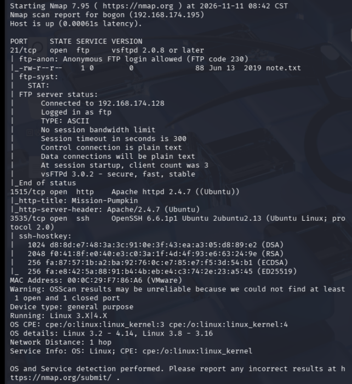

- 21端口ftp可匿名登录
- 1515端口是http服务
- 3535端口是ssh服务

# 端口分析

## 21端口

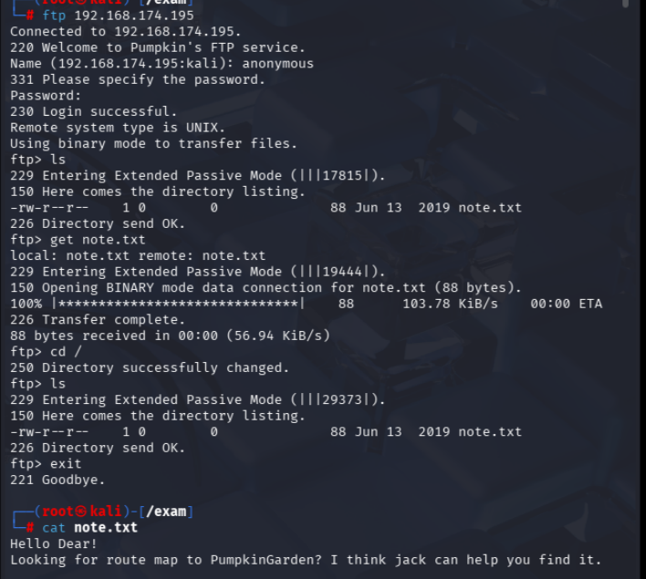

发现一个note.txt，线索指向jack

先尝试用jack爆破ftp，在后台先跑着

## 1515端口（http）

默认页面

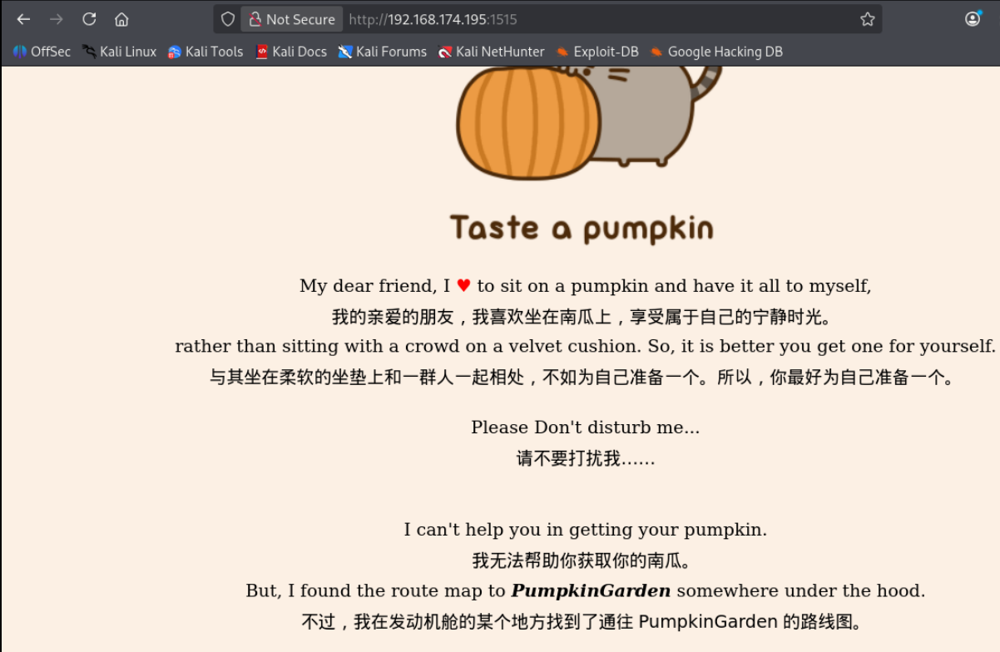

在源代码中发现

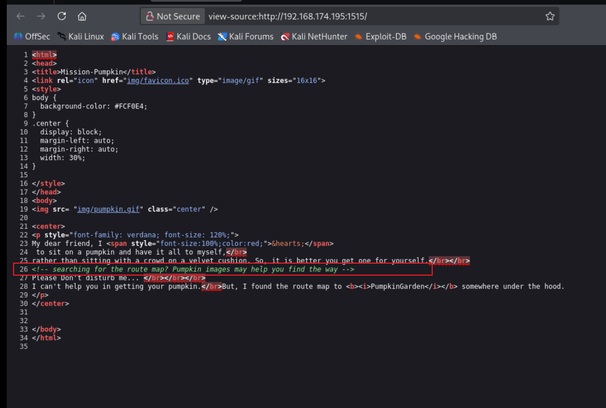

images会帮助我们，也许是一个目录，或者是一个文件，先枚举一下目录看看有没有相关信息

```
gobuster dir -u "http://192.168.174.195:1515" -w /usr/share/seclists/Discovery/Web-Content/DirBuster-2007_directory-list-2.3-big.txt -x php,zip,txt,html
```

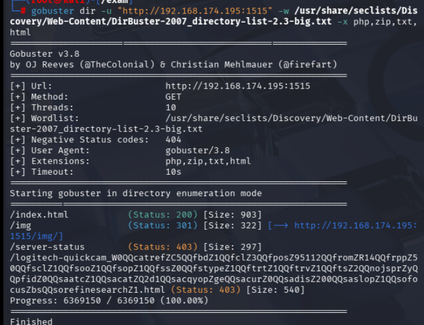

发现/img目录，查看

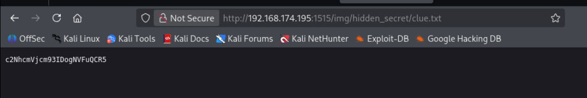

发现一个clue.txt文件，里面是加密内容，可能是base62或base64

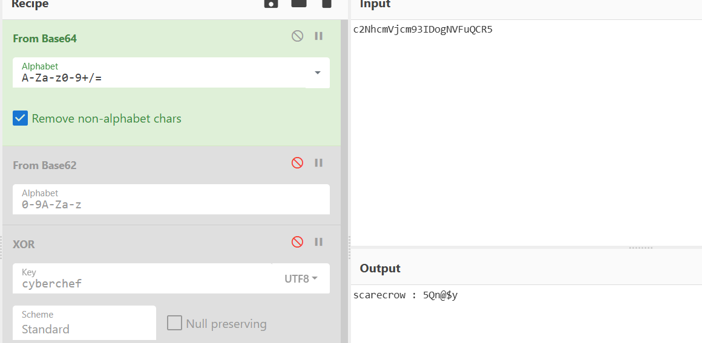

经过base64解码后得到

```
scarecrow : 5Qn@$y
```

尝试ssh连接

```
ssh scarecrow@192.168.174.195 -p3535
```

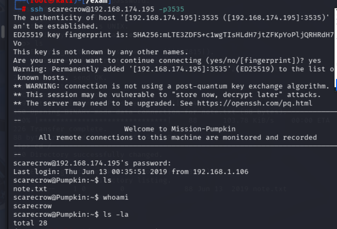

成功登录

# 提权

在其家目录下也发现一个note.txt

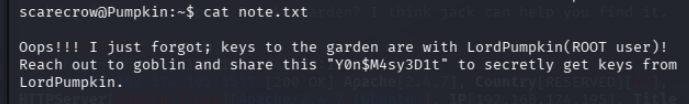

得到又一个账号密码

```
goblin：Y0n$M4sy3D1t
```

进行ssh连接

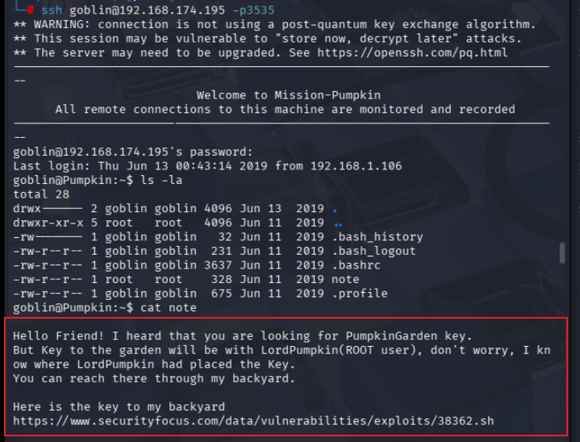

成功登录，并且也发现一个note，但感觉这里面的内容是混淆的，这个脚本根本下载不下来，而且其实有更简单的点

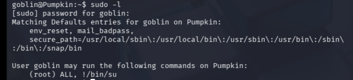

发现除了/bin/su，其他全部命令都可以直接以root身份运行

```
sudo /bin/bash
```

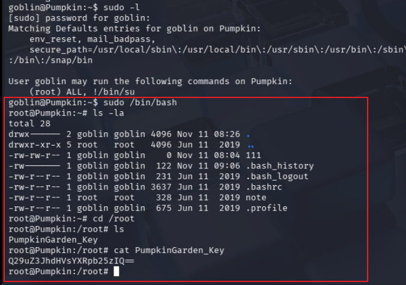

成功提权

[Mission-Pumpkin v1.0: PumpkinGarden（南瓜花园）靶机的渗透测试_3535端口-CSDN博客](https://blog.csdn.net/siaowei44/article/details/107088938)这位大佬的思路很好，可以看看