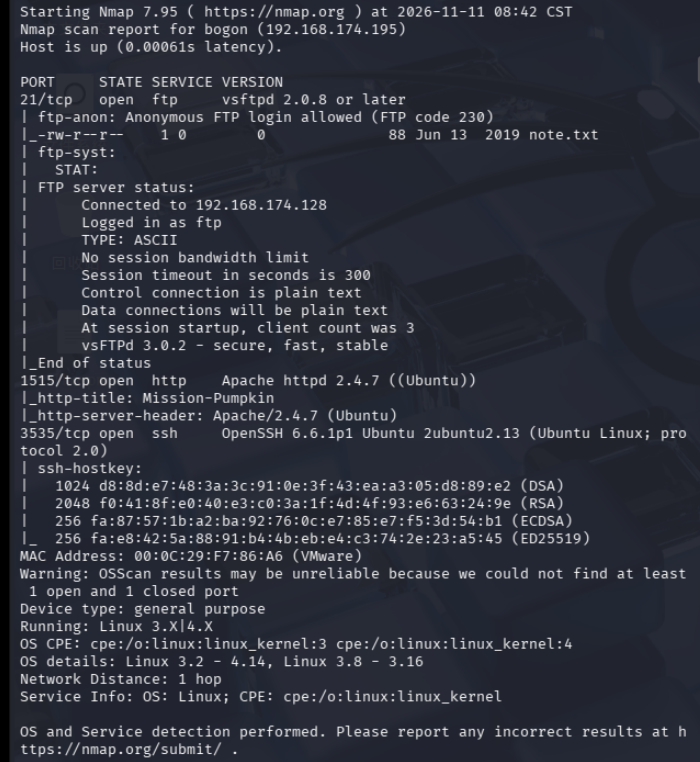

[TOC]

# 信息收集

```
arp-scan -l
nmap -p- --min-rate 10000 192.168.174.195 | awk -F ' ' '{print$1}' | awk -F '/' '{print$1}' | tr '\n' ','
```

扫到端口21,1515,3535

分别进行TCP详细扫描，漏洞扫描和UDP扫描，这里只有详细**TCP扫描**有结果，就只展示这个

```
nmap -sT -sC -sV -O -p21,1515,3535 192.168.174.195 -oA /nmapscan/tcp
```

