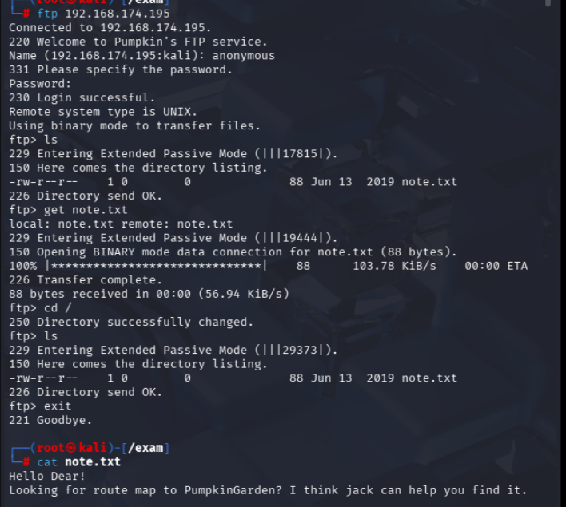
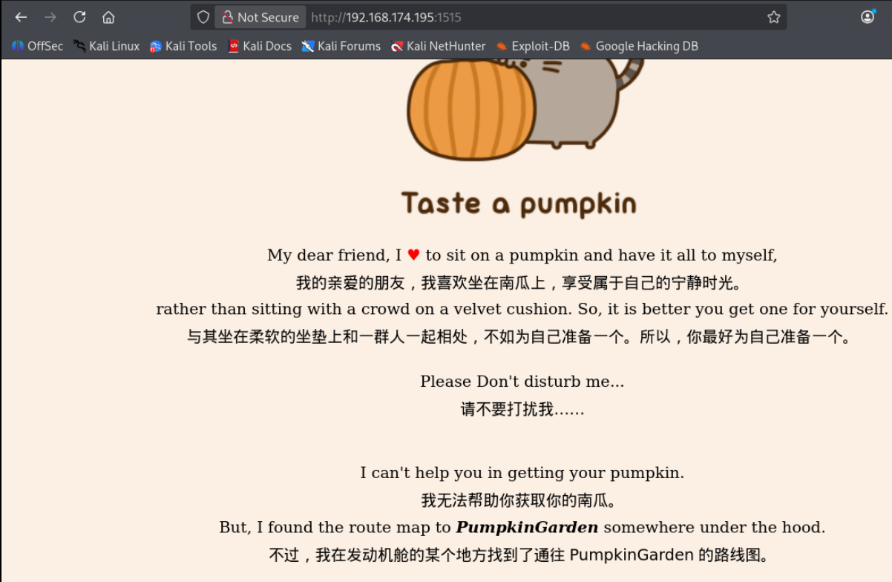
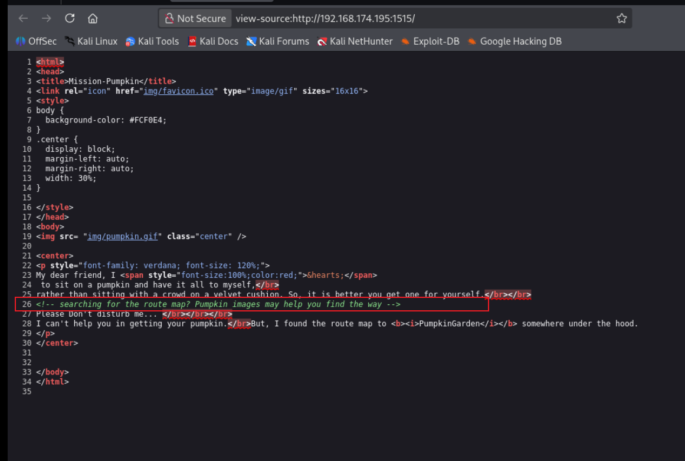

[TOC]

# 信息收集

```
arp-scan -l
nmap -p- --min-rate 10000 192.168.174.195 | awk -F ' ' '{print$1}' | awk -F '/' '{print$1}' | tr '\n' ','
```

扫到端口21,1515,3535

分别进行TCP详细扫描，漏洞扫描和UDP扫描，这里只有详细**TCP扫描**有结果，就只展示这个

```
nmap -sT -sC -sV -O -p21,1515,3535 192.168.174.195 -oA /nmapscan/tcp
```


- 21端口ftp可匿名登录
- 1515端口是http服务
- 3535端口是ssh服务

# 端口分析

## 21端口



发现一个note.txt，线索指向jack

先尝试用jack爆破ftp，在后台先跑着

## 1515端口（http）

默认页面



在源代码中发现



images会帮助我们，也许是一个目录，或者是一个文件，先枚举一下目录看看有没有相关信息